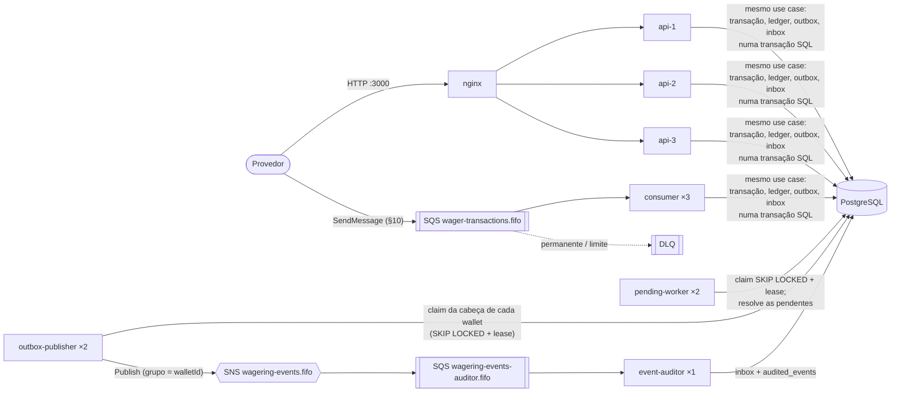

# distributed-wagering-processor

Processador distribuído de transações de apostas (`BET`, `WIN`, `LOSS`, `REFUND`, `ROLLBACK`), recebidas por HTTP e por SQS. O foco é correção financeira, concorrência e idempotência.

- Enunciado: [`docs/CHALLENGE.md`](docs/CHALLENGE.md)
- Requisitos, decisões e plano: [`docs/01-requisitos.md`](docs/01-requisitos.md), [`docs/02-decisoes.md`](docs/02-decisoes.md), [`docs/03-plano.md`](docs/03-plano.md)
- Como foi feito com IA: [`AI_WORKFLOW.md`](AI_WORKFLOW.md)

## Requisitos

- [Bun](https://bun.sh) 1.x
- Docker com Docker Compose

## Comandos

```bash
bun install

bun run infra:up          # Compose completo (topologia da D7.4, abaixo)
bun run infra:down
bun run infra:test:up     # infraestrutura dos testes (portas separadas)
bun run infra:test:down

bun run migration:up      # aplica as migrations (papel dono)
bun run migration:down    # desfaz todas
bun run migration:verify  # up → down → up no banco de teste

bun run check             # typecheck + lint + unit + migration:verify + integração + concorrência
bun run test:repeat concurrency 10   # n rodadas seguidas; log de cada falha em logs/test-repeat/
bun run test:proofs       # remove cada proteção e exige que o teste dela falhe (proofs/README.md)
bun run acceptance        # exemplos do §9 e do §10, literalmente
```

`bun run check` e `bun run test:proofs` precisam da infraestrutura de teste no ar (`bun run infra:test:up`); alguns testes também usam o Docker direto (um Postgres próprio, D21.7, e o `docker compose config`). No Compose de dev, o serviço `migrate` aplica as migrations antes dos processos subirem.

Para rodar a API ou as migrations **fora do Docker** (`bun run migration:up`, `bun run src/entrypoints/main-api.ts`), crie antes o `.env` a partir do exemplo:

```bash
cp .env.example .env              # Linux/Mac
Copy-Item .env.example .env       # Windows (PowerShell)
```

`bun run infra:up` e `bun run check` **não** precisam do `.env`: o Compose define as variáveis de cada serviço e os testes usam o `.env.test`.

> **Quem já tinha os containers de antes da S2 precisa recriá-los.** Os papéis do banco (`wagering_owner`, `wagering_app`) são criados pelo `scripts/postgres-init.sh`, que o Postgres só roda num volume novo:
>
> ```bash
> bun run infra:test:down && bun run infra:test:up    # testes
> docker compose down -v && bun run infra:up          # dev (apaga os dados locais)
> ```

## Processos

Um serviço só (um código, um banco, D12.2) rodando como vários processos com a mesma imagem e entrypoints diferentes (D7.4). Todos falam com o mesmo Postgres; a correção vem dos locks e das garantias do banco, nunca de estado em memória.



| Processo | Instâncias | Entrypoint | O que faz | Como as instâncias não se atrapalham |
|---|---|---|---|---|
| `nginx` | 1 | — | balanceia as 3 `api` na porta 3000; repete numa outra só erro de conexão (nunca um POST que já chegou) | — |
| `api` | 3 | `main-api.ts` | HTTP (§9) | lock da wallet + idempotência sob o lock (D3.6, D7.2) |
| `consumer` | 3 | `main-consumer.ts` | fila do §10, o mesmo use case do HTTP | inbox por `messageId` + lock da wallet (D3.7, D19.4) |
| `outbox-publisher` | 2 | `main-outbox-publisher.ts` | publica a outbox no SNS, em ordem por wallet | claim da cabeça com `SKIP LOCKED`, lease e dono (D20.3, D20.5) |
| `pending-worker` | 2 | `main-pending-worker.ts` | resolve as `PENDING_REFERENCE` | claim com `SKIP LOCKED`, lease e dono (D18.2, D18.10) |
| `event-auditor` | 1 | `main-event-auditor.ts` | confere a ordem e deduplica os eventos | inbox por `eventId` (D9.7, D20.1) |

**Shutdown (D8.5, D8.6, D21.2).** O bun é o PID 1 de cada container (`ENTRYPOINT`/`CMD` em forma exec, testado em `test/integration/infra/compose-topology.spec.ts`), então o `SIGTERM` do `docker compose stop` chega a ele, e o Compose dá 30 s para parar:
- `api`: readiness falsa, para de aceitar, termina as requisições em andamento (até 10 s) e só então fecha o banco;
- `consumer` e `event-auditor`: terminam o lote ou o long poll e devolvem o que não começaram (D19.9);
- `outbox-publisher` e `pending-worker`: terminam o item atual; os leases dos outros vencem sozinhos.

Morto à força no meio da carga, nada se perde nem duplica: a transação desfeita volta pela reentrega ou pelo reenvio do provedor (mesma key), o lease vence e outra instância continua. É o R-13-C8, provado com todos os processos separados em `test/concurrency/restart.spec.ts`.

**Prazos.** Cada requisição tem 10 s (`HTTP_REQUEST_TIMEOUT_MS`, D21.3): estourado, `503` com `Retry-After: 1`; o trabalho não é cancelado e o reenvio com a mesma key cai no replay. O nginx espera 15 s, para o `503` da api chegar antes do `504` dele. Lease do worker e visibilidade do consumidor são configuráveis e validados na subida contra o tamanho do lote (D21.6); ver [`src/shared/config/README.md`](src/shared/config/README.md).

**Onde está provado:**

| Requisito | Teste |
|---|---|
| R-13-C4, R-05-08, R-08-06: 3 processos na mesma wallet | `test/concurrency/multi-instance.spec.ts` (3 `api` + 3 `consumer` reais, waiters de 3 processos no `pg_locks` por `application_name`, D21.1) |
| R-13-C6: dois publishers em processos separados | `test/concurrency/outbox-processes.spec.ts` (D21.4) |
| R-13-C8, R-13-I6: reinício no meio da carga | `test/concurrency/restart.spec.ts` (topologia inteira; reconciliação de todas as wallets do teste, D21.5) |
| D5, R-13-I6: Postgres fora e reiniciado | `test/integration/failures/postgres-restart.spec.ts` (Postgres próprio do teste, D21.7) |
| D5, B7.7: SQS fora | `test/integration/failures/sqs-down.spec.ts` |
| D5, D21.3: prazo da requisição | `test/integration/http/request-timeout.spec.ts` |
| D8.6: shutdown | `test/integration/shutdown/shutdown.spec.ts`; sinal real em `sigterm.spec.ts`, que só roda no Linux (CI) e foi conferido à mão com `docker stop` nos 11 processos, saída 0 ([`test/README.md`](test/README.md)) |

## Infraestrutura

| Serviço | Dev (`docker-compose.yml`) | Testes (`docker-compose.test.yml`) |
|---|---|---|
| nginx (api ×3) | `localhost:3000` | — (os testes sobem a api no próprio processo ou em processos separados) |
| Postgres 16 | `localhost:5432`, banco `wagering` | `localhost:5433`, banco `wagering_test` |
| LocalStack 3 (SQS, SNS) | `localhost:4566` | `localhost:4567` |

Variáveis: `.env.example` (dev) e `.env.test` (testes). Nenhum segredo real.

O Postgres tem três papéis (D7.3): `postgres` só para o init do container, `wagering_owner` para as migrations (`DB_MIGRATION_USER`) e `wagering_app` para a aplicação e os testes (`DB_USER`), sem `UPDATE`/`DELETE` no ledger. Detalhes em [`src/modules/wagering/infra/persistence/README.md`](src/modules/wagering/infra/persistence/README.md).

O `scripts/localstack-init.sh` roda dentro do LocalStack quando ele fica pronto e cria:

| Recurso | Atributos | Decisão |
|---|---|---|
| `wager-transactions.fifo` | FIFO, deduplicação por conteúdo, redrive para a DLQ com `maxReceiveCount = 20` | D8.1, D8.3 |
| `wager-transactions-dlq.fifo` | FIFO | D8.2 |
| `wagering-events.fifo` (SNS) | tópico FIFO | D9.1 |
| `wagering-events-auditor.fifo` | FIFO, assinante do tópico (entrega raw) | D9.7 |

Por causa da deduplicação por conteúdo, a mensagem do §10 entra com só `--message-group-id` (D8.1):

```bash
docker compose exec localstack awslocal sqs send-message \
  --queue-url http://localhost:4566/000000000000/wager-transactions.fifo \
  --message-group-id <walletId> \
  --message-body '<json do §10>'
```

O `awslocal` roda dentro do container; não precisa de Python na máquina.

O `.sh` tem que ter fim de linha LF (`.gitattributes`), senão quebra dentro do container.

## Partes

| Parte | README |
|---|---|
| Domínio (dinheiro, wallet, ledger, transação, eventos) | [`src/modules/wagering/README.md`](src/modules/wagering/README.md) |
| Persistência (schema, garantias no banco, ORM, migrations) | [`src/modules/wagering/infra/persistence/README.md`](src/modules/wagering/infra/persistence/README.md) |
| Use cases (abrir wallet, consultas, reconciliação) | [`src/modules/wagering/application/README.md`](src/modules/wagering/application/README.md) |
| API HTTP das wallets (endpoints, permissões, cursor) — Swagger em `/docs` | [`src/modules/wagering/infra/http/README.md`](src/modules/wagering/infra/http/README.md) |
| Autenticação (JWT, papéis, guard) | [`src/shared/auth/README.md`](src/shared/auth/README.md) |
| Erros → HTTP (`classifyError`) | [`src/shared/errors/README.md`](src/shared/errors/README.md) |
| HTTP comum (correlação, validação, Swagger) | [`src/shared/http/README.md`](src/shared/http/README.md) |
| Métricas | [`src/shared/metrics/README.md`](src/shared/metrics/README.md) |
| Configuração | [`src/shared/config/README.md`](src/shared/config/README.md) |
| Segredos | [`src/shared/secrets/README.md`](src/shared/secrets/README.md) |
| Logs | [`src/shared/logger/README.md`](src/shared/logger/README.md) |
| Health | [`src/shared/health/README.md`](src/shared/health/README.md) |
| Testes (suítes, regras, processos separados, plataforma) | [`test/README.md`](test/README.md) |
| Provas (cada proteção removida derruba um teste) | [`proofs/README.md`](proofs/README.md) |

Os testes da infraestrutura de filas estão em `test/integration/localstack-infra.spec.ts`.
