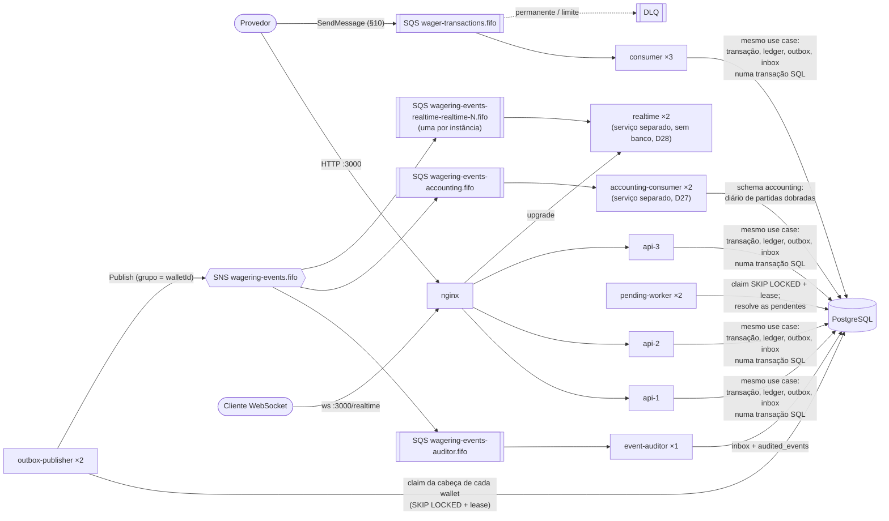

# distributed-wagering-processor

[](https://github.com/basedCaesar/distributed-wagering-processor/actions/workflows/ci.yml)

Processador distribuído de transações de apostas (`BET`, `WIN`, `LOSS`, `REFUND`, `ROLLBACK`), recebidas por HTTP e por SQS. O foco é correção financeira, concorrência e idempotência.

- Enunciado: [`docs/CHALLENGE.md`](docs/CHALLENGE.md)
- Arquitetura, decisões, trade-offs e limitações: [`ARCHITECTURE.md`](ARCHITECTURE.md)
- Requisitos, decisões e plano: [`docs/01-requisitos.md`](docs/01-requisitos.md), [`docs/02-decisoes.md`](docs/02-decisoes.md), [`docs/03-plano.md`](docs/03-plano.md)
- Como foi feito com IA: [`AI_WORKFLOW.md`](AI_WORKFLOW.md)

## Requisitos

- [Bun](https://bun.sh) 1.x
- Docker com Docker Compose
- `curl` (já vem no Linux, no macOS e no Windows 10+)

Portas usadas pelo Compose de dev: 3000 (api e WebSocket em `/realtime`), 5432 (Postgres), 4566 (LocalStack) e 8080 (Keycloak); pelo de teste: 5433, 4567 e 8081. Se alguma estiver ocupada: [Se uma porta estiver ocupada](#se-uma-porta-estiver-ocupada).

## Começo rápido

```bash
git clone https://github.com/basedCaesar/distributed-wagering-processor.git distributed-wagering-processor
cd distributed-wagering-processor
bun install
bun run infra:up          # (re)constrói a imagem e sobe tudo (a 1ª vez demora alguns minutos)
bun run acceptance        # roda os exemplos do §9 e do §10 como estão escritos
```

O `bun run acceptance` espera a api ficar pronta (até 3 min), pede os tokens ao Keycloak e roda, nesta ordem:
- a criação de wallet e a BET do §9, literais, com o header `Authorization`;
- a mensagem do §10, literal, só com `--message-group-id`;
- as consultas e a reconciliação.

Cada passo é conferido, e qualquer divergência faz o comando sair com erro. O §10 é conferido pela linha da inbox do consumidor (`msg-123`), consultada com o papel da app dentro do container do Postgres. Pode rodar de novo: o resultado é o mesmo, com `idempotentReplay: true`, e o §10 avisa que a inbox já tinha a mensagem, sem afirmar um novo processamento (D23.6). `ACCEPTANCE_API_URL` e `ACCEPTANCE_KEYCLOAK_URL` trocam os hosts, se precisar (D23.7). A aceitação fica fora do `bun run check`, porque precisa do Compose de dev completo.

## Como avaliar

Roteiro para quem nunca viu o projeto, na ordem. Os tempos são os medidos na máquina de desenvolvimento (Windows 11, Docker Desktop no WSL2, Ryzen 7 3700X, ambiente em [`docs/load-test.md`](docs/load-test.md#ambiente)); numa máquina Linux costuma ser mais rápido. Os comandos funcionam no Git Bash, no Linux e no macOS; no PowerShell, só a função do token muda ([Token](#token-keycloak-d101-d23)).

### 1. Subir tudo e rodar os exemplos do enunciado (≈ 5 min)

```bash
bun install               # ≈ 30 s
bun run infra:up          # 1ª vez ≈ 4 min 30 s (build da imagem e import do realm no Keycloak); depois ≈ 1 min
bun run acceptance        # ≈ 5 s; pode rodar de novo (a 2ª vez é o replay)
```

Sobe os 15 processos da topologia (tabela em [Processos](#processos)), o Postgres, o LocalStack e o Keycloak, e cria a wallet do exemplo ([seed](#a-wallet-do-exemplo-já-existe-seed-d231)). A aceitação termina com `Aceitação: tudo ok` e sai com 0; qualquer divergência sai com erro e diz qual passo falhou. Os mesmos `curl`, para rodar à mão: [Exemplos do enunciado](#exemplos-do-enunciado-9-e-10).

### 2. Explorar a API pelo Swagger (≈ 5 min)

1. Abra <http://localhost:3000/docs> (aberto, sem token).
2. Gere um token no terminal. Linux, macOS ou Git Bash:

   ```bash
   curl -s -X POST http://localhost:8080/realms/wagering/protocol/openid-connect/token \
     -d grant_type=client_credentials -d client_id=operator -d client_secret=operator-dev-secret \
     | sed -E 's/.*"access_token":"([^"]+)".*/\1/'
   ```

   Troque `operator` por `provider-a` (e o segredo por `provider-a-dev-secret`) para submeter transações; os papéis estão na [tabela dos clients](#token-keycloak-d101-d23).
3. **Authorize** (cadeado no topo), cole o token **sem** o prefixo `Bearer` e confirme.
4. **Try it out** em qualquer endpoint. O token vale 5 minutos; vencido, a api responde `401`, e é só gerar outro.

### 3. Rodar os testes (≈ 10 min)

```bash
bun run infra:down        # recomendado: o Compose de dev disputa CPU com os testes de concorrência
bun run infra:test:up     # Postgres, LocalStack e Keycloak de teste, em portas próprias; 1ª vez ≈ 2 min 15 s, depois ≈ 30 s
bun run check             # typecheck, lint, unidade, migrations, integração, concorrência e e2e: ≈ 7 min 30 s
```

O `check` termina sem nenhuma falha. **No Windows, 7 testes aparecem como `skip`**: são o `SIGTERM` real, que o Windows não entrega (o processo morre à força); no CI, em Linux, eles rodam e o job falha se algum for pulado ([`test/README.md`](test/README.md#plataforma-o-sigterm-real-só-roda-fora-do-windows-no-ci-sempre)). Depois, `bun run infra:test:down` e, para os próximos passos, `bun run infra:up` de novo.

### 4. Conferir o diário de partidas dobradas (≈ 10 s)

```bash
bun run accounting:reconcile --wait 120
```

Roda num container na rede do Compose de dev e compara o diário (cada lançamento debita uma conta e credita outra) com o saldo de cada wallet do núcleo. Sai com 0 e imprime `"consistent": true`, `"settled": true` e o `trialBalance` de cada moeda com `"balanced": true`. Com `--wait`, espera o diário alcançar os eventos ainda não consumidos. Como funciona: [`src/modules/accounting/README.md`](src/modules/accounting/README.md).

### 5. Ver o tempo real (≈ 2 min)

**Terminal 1**, seguindo a wallet do exemplo:

```bash
bun run realtime:watch 0192f291-27dd-7d3f-8071-5f8685deef37
```

Ele faz o GET inicial (uma linha com o saldo e a `version`) e fica esperando.

**Terminal 2**, uma BET de 10.00 com uma key nova (o `token` é a função de [Token](#token-keycloak-d101-d23)):

```bash
PROVIDER_TOKEN=$(token provider-a)
KEY="demo-$(date +%s)"
curl -s -X POST http://localhost:3000/wagering/transactions \
  -H "Authorization: Bearer $PROVIDER_TOKEN" -H "Idempotency-Key: provider-a:$KEY" -H "Content-Type: application/json" \
  -d '{"providerId":"provider-a","externalTransactionId":"'"$KEY"'","playerId":"0192f28f-5dc0-7d58-bdb2-814ad6a0f4a1","walletId":"0192f291-27dd-7d3f-8071-5f8685deef37","roundId":"round-demo","gameId":"fortune-chimp","kind":"BET","money":{"amount":"10.00","currency":"BRL"}}'
```

No terminal 1, os eventos da BET aparecem em menos de 1 s (o saldo cai 10.00 e a `version` sobe). **Antes de rodar a aceitação de novo, desfaça a BET da demonstração**: a aceitação confere o saldo de 975.00 depois da BET do §9. O `ROLLBACK` também aparece no terminal 1:

```bash
curl -s -X POST http://localhost:3000/wagering/transactions \
  -H "Authorization: Bearer $PROVIDER_TOKEN" -H "Idempotency-Key: provider-a:$KEY-rb" -H "Content-Type: application/json" \
  -d '{"providerId":"provider-a","externalTransactionId":"'"$KEY"'-rb","playerId":"0192f28f-5dc0-7d58-bdb2-814ad6a0f4a1","walletId":"0192f291-27dd-7d3f-8071-5f8685deef37","roundId":"round-demo","gameId":"fortune-chimp","kind":"ROLLBACK","referenceExternalTransactionId":"'"$KEY"'","money":{"amount":"10.00","currency":"BRL"}}'
```

`Ctrl+C` encerra o `realtime:watch`. O WebSocket é notificação; a verdade é o `GET /wallets/:id`. Protocolo, permissões e reconexão: [`src/modules/realtime/README.md`](src/modules/realtime/README.md).

### 6. Teste de carga (opcional)

```bash
bun run infra:test:down   # o test:load aborta com o Compose de teste no ar
bun run infra:up
bun run test:load --rounds 1   # uma rodada, ≈ 30 min, para ver funcionando
bun run test:load              # as 3 rodadas do relatório, ≈ 1 h 30
```

O relatório sai em `logs/load/<execução>/report.md`. Só a correção depois da carga ou um status inesperado reprovam; latência nunca reprova. Números, ambiente e análise das 3 rodadas: [`docs/load-test.md`](docs/load-test.md).

### 7. CI e provas

- **CI:** o badge no topo deste README mostra o último push; o histórico fica na aba **Actions** do GitHub (como ler uma rodada e onde ficam os logs: [CI](#ci)).
- **Provas:** cada proteção (lock, constraint, trigger, inbox, papel do banco) é removida por um patch, e um teste nomeado precisa falhar. Lista, resultado e o que cada uma prova: [`proofs/README.md`](proofs/README.md). Para rodar: `bun run test:proofs`, com a infra de teste no ar, ou o workflow **Proofs** na aba Actions.

### Se uma porta estiver ocupada

| Porta | Quem usa | Compose |
|---|---|---|
| 3000 | nginx (api e WebSocket `/realtime`) | dev |
| 5432 | Postgres | dev |
| 4566 | LocalStack | dev |
| 8080 | Keycloak | dev |
| 5433 | Postgres de teste | teste |
| 4567 | LocalStack de teste | teste |
| 8081 | Keycloak de teste | teste |

O sintoma é o `docker compose up` falhar com `ports are not available` ou `address already in use`. Para achar quem ocupa a porta:

```bash
netstat -ano | findstr :5432      # Windows (PowerShell ou cmd): o último número é o PID
tasklist /FI "PID eq <pid>"       # Windows: o nome do processo
lsof -nP -iTCP:5432 -sTCP:LISTEN  # Linux e macOS
```

O mais simples é parar esse processo. Se não der, troque a porta do host no Compose de dev com um `docker-compose.override.yml` na raiz do repositório (o Compose o lê sozinho; `!override` exige o Compose 2.24 ou mais novo):

```yaml
services:
  postgres:
    ports: !override
      - "15432:5432"
```

Nesta máquina, por exemplo, há um PostgreSQL nativo do Windows na 5432. A 5432 do host só é usada por quem roda fora do Docker (`bun run migration:up`, a api fora do container): a aceitação e o `accounting:reconcile` falam com o Postgres de dentro da rede do Compose. Para trocar a 3000 ou a 8080, use também `ACCEPTANCE_API_URL` / `ACCEPTANCE_KEYCLOAK_URL` na aceitação e `--api`, `--url` e `--keycloak` no `realtime:watch`. As portas de teste estão no `docker-compose.test.yml` e no `.env.test`; trocá-las exige mudar os dois.

## Comandos

```bash
bun install

bun run infra:up          # Compose completo (topologia da D7.4, abaixo), com Keycloak e seed; `--build`: sempre o código atual (D23.8)
bun run infra:down
bun run infra:test:up     # infraestrutura dos testes (portas separadas, com Keycloak de teste)
bun run infra:test:down

bun run migration:up      # aplica as migrations (papel dono)
bun run migration:down    # desfaz todas
bun run migration:verify  # up → down → up no banco de teste

bun run check             # typecheck + lint + unit + migration:verify + integração + concorrência + e2e
bun run test:e2e          # e2e com o Keycloak real (D10.3, D23.5)
bun run test:repeat concurrency 10   # n rodadas seguidas; resumo sempre e log de cada falha em logs/test-repeat/
bun run test:proofs       # remove cada proteção e exige que o teste dela falhe (proofs/README.md)
bun run acceptance        # exemplos do §9 e do §10, literalmente, contra o Compose de dev
bun run test:load         # teste de carga (k6) contra o Compose de dev, 3 rodadas; --rounds N para iterar (D26)
bun run accounting:reconcile [--player-prefix p] [--wait s]  # diário de partidas dobradas × núcleo, num container na rede do Compose de dev (D27.7)
bun run realtime:watch <walletId> [--client provider-a]      # segue uma wallet por WebSocket e imprime cada evento (D28.13)
```

`bun run check` e `bun run test:proofs` precisam da infraestrutura de teste no ar (`bun run infra:test:up`); alguns testes também usam o Docker direto (um Postgres próprio, D21.7, e o `docker compose config`). No Compose de dev, o serviço `migrate` aplica as migrations antes dos processos subirem.

Para rodar a API ou as migrations **fora do Docker** (`bun run migration:up`, `bun run src/entrypoints/main-api.ts`), crie antes o `.env` a partir do exemplo:

```bash
cp .env.example .env              # Linux/Mac
Copy-Item .env.example .env       # Windows (PowerShell)
```

`bun run infra:up` e `bun run check` **não** precisam do `.env`: o Compose define as variáveis de cada serviço e os testes usam o `.env.test`.

## Teste de carga

`bun run test:load` (D26) roda o k6 num container na rede do Compose de dev, contra o nginx e as 3 `api` e pela fila. São 4 cenários: throughput em degraus, hot wallet, duplicatas da mesma key e mensagens do §10. O `/metrics` interno de cada processo é lido antes e depois de cada passo, sem porta exposta. No fim de cada rodada vem a checagem de correção: reconciliação de todas as wallets criadas e consultas no banco. **Só a correção ou um status inesperado reprovam**; latência nunca reprova, porque o §14 não tem meta de RPS.

```bash
bun run infra:test:down   # o test:load aborta com o Compose de teste no ar
bun run infra:up
bun run test:load         # 3 rodadas, cerca de 1h30; relatório em logs/load/<execução>/report.md
```

Números, ambiente e análise: [`docs/load-test.md`](docs/load-test.md). Como funciona: [`load/README.md`](load/README.md). Fica fora do `check` e do CI.

## CI

GitHub Actions, em Linux (`ubuntu-latest`), com o Bun 1.4.4 e as actions em versões exatas (D25). Todo step roda com `bash -eo pipefail` (D25.9): um comando que falha antes de um `| tee` reprova o step.

| Workflow | Quando | O que roda |
|---|---|---|
| [`ci.yml`](.github/workflows/ci.yml) | todo push e pull request | job `check`: `infra:test:up` e `bun run check` inteiro; falha se algum teste for pulado (a única exceção é um teste instável conhecido do realtime, D25.10, [`test/README.md`](test/README.md#teste-instável-conhecido-d2510)) e exige os 7 `SIGTERM` reais (D25.3, D27.9, D28.12). Job `acceptance`: `infra:up`, `bun run acceptance` duas vezes (a 2ª é o replay), com o `realtime:watch` seguindo a wallet do exemplo na 1ª e exigindo o evento da BET (D28.13), e `accounting:reconcile` (D27.7) |
| [`proofs.yml`](.github/workflows/proofs.yml) | manual (`workflow_dispatch`) e toda segunda, 06:00 UTC | `bun run test:proofs` (D25.5) |

O badge no topo mostra o resultado do `ci.yml` no último push. Para ver uma rodada:

1. **Actions** no GitHub → o workflow → a rodada.
2. Cada job mostra o log de cada step. No `check`, o step "conferir os pulados (só a exceção da D25.10) e os 7 SIGTERM reais" lista os 7 testes do sinal real que passaram.
3. Se a rodada falhou, os logs ficam em **Artifacts**, no fim da página da rodada, por 14 dias: `check-logs`, `acceptance-logs` ou `proofs-logs`. É a pasta `logs/` do runner, com a saída dos testes, o log de cada processo separado (`logs/processes/`) e os logs dos containers (`logs/ci/compose-*.log`).

Para rodar as provas na hora: **Actions** → **Proofs** → **Run workflow**.

Linha de comando, com o [`gh`](https://cli.github.com): `gh run list`, `gh run watch`, `gh run view <id> --log-failed`, `gh run download <id>` (artefatos) e `gh workflow run proofs.yml`.

## Exemplos do enunciado (§9 e §10)

### Token (Keycloak, D10.1, D23)

O Keycloak (`localhost:8080`) importa o realm `wagering` do repositório ([`keycloak/README.md`](keycloak/README.md)) e emite tokens por `client_credentials`. **Os segredos abaixo são de desenvolvimento, não segredos reais.**

| Client | Segredo | Papel | Pode |
|---|---|---|---|
| `operator` | `operator-dev-secret` | `operator` | criar wallet, reconciliar, consultar tudo |
| `provider-a` | `provider-a-dev-secret` | `provider` (`provider_id = provider-a`) | submeter com `providerId: provider-a`, consultar as próprias transações e as wallets |
| `provider-b` | `provider-b-dev-secret` | `provider` (`provider_id = provider-b`) | o mesmo, como `provider-b` |

Linux, macOS ou Git Bash:

```bash
token() {
  curl -s -X POST http://localhost:8080/realms/wagering/protocol/openid-connect/token \
    -d grant_type=client_credentials -d client_id="$1" -d client_secret="$1-dev-secret" \
    | sed -E 's/.*"access_token":"([^"]+)".*/\1/'
}
OPERATOR_TOKEN=$(token operator)
PROVIDER_TOKEN=$(token provider-a)
```

PowerShell:

```powershell
function Get-Token($client) {
  (Invoke-RestMethod -Method Post -Uri http://localhost:8080/realms/wagering/protocol/openid-connect/token `
    -Body @{ grant_type = "client_credentials"; client_id = $client; client_secret = "$client-dev-secret" }).access_token
}
$OPERATOR_TOKEN = Get-Token operator
$PROVIDER_TOKEN = Get-Token provider-a
```

O token vale 5 minutos. O emissor (`iss`) é sempre `http://localhost:8080/realms/wagering`, qualquer que seja o host usado para pedi-lo (D23.3).

### A wallet do exemplo já existe (seed, D23.1)

A BET do §9 e a mensagem do §10 usam a wallet `0192f291-27dd-7d3f-8071-5f8685deef37`, mas o `POST /wallets` gera um id novo a cada wallet (UUIDv7, D6.6). Para os exemplos funcionarem como estão escritos, o serviço `seed` do Compose de dev cria essa wallet antes da api subir. Ele usa o mesmo use case do `POST /wallets`, com o mesmo id do enunciado, o player `0192f28f-5dc0-7d58-bdb2-814ad6a0f4a1` e `1000.00 BRL`. Por isso:
- a **criação literal** do §9 devolve `409 WALLET_ALREADY_EXISTS` com esse `walletId`. É o conflito que o §9 pede para "wallet duplicada para o mesmo `playerId` + `currency`";
- a **BET** e o **§10** funcionam como estão escritos.

O seed existe só no Compose de dev, e rodá-lo de novo não faz nada. Se o banco já tiver uma wallet desse player com **outro** id (por exemplo, criada pelo `curl` do §9 num volume antigo), o seed falha com `SEED_EXAMPLE_WALLET_MISMATCH` e a api não sobe. Para recomeçar com o banco limpo:

```bash
bun run infra:down -v && bun run infra:up
```

### §9 Criar wallet

Literal (devolve `409`, porque o seed já criou essa wallet):

```bash
curl -i -X POST http://localhost:3000/wallets \
  -H "Authorization: Bearer $OPERATOR_TOKEN" \
  -H "Content-Type: application/json" \
  -d '{
  "playerId": "0192f28f-5dc0-7d58-bdb2-814ad6a0f4a1",
  "initialBalance": { "amount": "1000.00", "currency": "BRL" }
}'
# 409 {"error":{"code":"WALLET_ALREADY_EXISTS",...,"details":{"walletId":"0192f291-27dd-7d3f-8071-5f8685deef37"}}}
```

Para ver o `201`, a mesma criação com outro `playerId`:

```bash
curl -i -X POST http://localhost:3000/wallets \
  -H "Authorization: Bearer $OPERATOR_TOKEN" \
  -H "Content-Type: application/json" \
  -d '{
  "playerId": "player-readme-1",
  "initialBalance": { "amount": "1000.00", "currency": "BRL" }
}'
# 201 {"id":"<uuid v7 novo>","playerId":"player-readme-1","balance":{"amount":"1000.00","currency":"BRL"},"version":1}
```

### §9 Submeter transação

```bash
curl -i -X POST http://localhost:3000/wagering/transactions \
  -H "Authorization: Bearer $PROVIDER_TOKEN" \
  -H "Idempotency-Key: provider-a:transaction-123" \
  -H "Content-Type: application/json" \
  -d '{
  "providerId": "provider-a",
  "externalTransactionId": "transaction-123",
  "playerId": "0192f28f-5dc0-7d58-bdb2-814ad6a0f4a1",
  "walletId": "0192f291-27dd-7d3f-8071-5f8685deef37",
  "roundId": "round-987",
  "gameId": "fortune-chimp",
  "kind": "BET",
  "money": { "amount": "25.00", "currency": "BRL" }
}'
# 200 {"transactionId":"…","status":"PROCESSED","balance":{"amount":"975.00","currency":"BRL"},"idempotentReplay":false}
```

Repetir o mesmo comando devolve o mesmo corpo, com `"idempotentReplay": true`.

### §9 Consultas e reconciliação

```bash
curl -s http://localhost:3000/wallets/0192f291-27dd-7d3f-8071-5f8685deef37 -H "Authorization: Bearer $OPERATOR_TOKEN"
curl -s "http://localhost:3000/wallets/0192f291-27dd-7d3f-8071-5f8685deef37/ledger?limit=50" -H "Authorization: Bearer $OPERATOR_TOKEN"
curl -s http://localhost:3000/wagering/transactions/<transactionId> -H "Authorization: Bearer $PROVIDER_TOKEN"
curl -s http://localhost:3000/providers/provider-a/wagering/transactions/transaction-123 -H "Authorization: Bearer $PROVIDER_TOKEN"
curl -s -X POST http://localhost:3000/wallets/0192f291-27dd-7d3f-8071-5f8685deef37/reconciliation -H "Authorization: Bearer $OPERATOR_TOKEN"
curl -s http://localhost:3000/health/live      # sem token
curl -s http://localhost:3000/health/ready     # sem token
```

A documentação de todos os endpoints, com corpos e status, está no Swagger: <http://localhost:3000/docs>.

### §10 Mensagem na fila

A mensagem do §10, exatamente como está, só com `--message-group-id` (a fila tem deduplicação por conteúdo, D8.1). O `awslocal` roda dentro do container, então não precisa de Python na máquina:

```bash
docker compose exec localstack awslocal sqs send-message \
  --queue-url http://localhost:4566/000000000000/wager-transactions.fifo \
  --message-group-id 0192f291-27dd-7d3f-8071-5f8685deef37 \
  --message-body '{
  "messageId": "msg-123",
  "type": "WagerTransactionRequested",
  "occurredAt": "2026-07-29T15:00:00.000Z",
  "data": {
    "providerId": "provider-a",
    "externalTransactionId": "transaction-123",
    "idempotencyKey": "provider-a:transaction-123",
    "playerId": "0192f28f-5dc0-7d58-bdb2-814ad6a0f4a1",
    "walletId": "0192f291-27dd-7d3f-8071-5f8685deef37",
    "roundId": "round-987",
    "gameId": "fortune-chimp",
    "kind": "BET",
    "money": { "amount": "25.00", "currency": "BRL" }
  }
}'
```

É a mesma operação da BET do §9 (mesma key, mesmo `payloadHash`, D3.3). Se a BET já foi enviada por HTTP, o consumidor dá ack num replay e o saldo continua `975.00`, com um único débito no ledger. Se a mensagem chegar primeiro, ela debita, e o `curl` da BET devolve o replay. O `MessageGroupId` recomendado é o `walletId` (ordem por wallet), mas qualquer grupo é aceito (D8.1).

## Processos

Um serviço só (um código, um banco, D12.2) rodando como vários processos com a mesma imagem e entrypoints diferentes (D7.4). Todos falam com o mesmo Postgres; a correção vem dos locks e das garantias do banco, nunca de estado em memória.



| Processo | Instâncias | Entrypoint | O que faz | Como as instâncias não se atrapalham |
|---|---|---|---|---|
| `nginx` | 1 | — | balanceia as 3 `api` na porta 3000 e o WebSocket `/realtime` nas 2 `realtime`; repete numa outra só erro de conexão (nunca um POST que já chegou) | — |
| `api` | 3 | `main-api.ts` | HTTP (§9) | lock da wallet + idempotência sob o lock (D3.6, D7.2) |
| `consumer` | 3 | `main-consumer.ts` | fila do §10, o mesmo use case do HTTP | inbox por `messageId` + lock da wallet (D3.7, D19.4) |
| `outbox-publisher` | 2 | `main-outbox-publisher.ts` | publica a outbox no SNS, em ordem por wallet | claim da cabeça com `SKIP LOCKED`, lease e dono (D20.3, D20.5) |
| `pending-worker` | 2 | `main-pending-worker.ts` | resolve as `PENDING_REFERENCE` | claim com `SKIP LOCKED`, lease e dono (D18.2, D18.10) |
| `event-auditor` | 1 | `main-event-auditor.ts` | confere a ordem e deduplica os eventos | inbox por `eventId` (D9.7, D20.1) |
| `accounting-consumer` | 2 | `main-accounting-consumer.ts` | diário de partidas dobradas, com papel próprio no banco ([`accounting`](src/modules/accounting/README.md)) | inbox por `eventId` + lock da conta da wallet (D27.4) |
| `realtime` | 2 (`realtime-1`, `realtime-2`) | `main-realtime.ts` | WebSocket: notifica os clientes dos eventos das wallets que eles seguem, sem banco ([`realtime`](src/modules/realtime/README.md)) | uma fila por instância, pelo id estável: cada uma recebe todos os eventos (D28.5) |

**Shutdown (D8.5, D8.6, D21.2).** O bun é o PID 1 de cada container (`ENTRYPOINT`/`CMD` em forma exec, testado em `test/integration/infra/compose-topology.spec.ts`), então o `SIGTERM` do `docker compose stop` chega a ele, e o Compose dá 30 s para parar:
- `api`: readiness falsa, para de aceitar, termina as requisições em andamento (até 10 s) e só então fecha o banco;
- `consumer`, `event-auditor` e `accounting-consumer`: terminam o lote ou o long poll e devolvem o que não começaram (D19.9);
- `outbox-publisher` e `pending-worker`: terminam o item atual; os leases dos outros vencem sozinhos;
- `realtime`: fecha os sockets com `1001` (os clientes reconectam na outra instância pelo nginx) e deixa o long poll terminar; a fila e a assinatura ficam (D28.5).

Morto à força no meio da carga, nada se perde nem duplica: a transação desfeita volta pela reentrega ou pelo reenvio do provedor (mesma key), o lease vence e outra instância continua. É o R-13-C8, provado com todos os processos separados em `test/concurrency/restart.spec.ts`.

**Prazos.** Cada requisição tem 10 s (`HTTP_REQUEST_TIMEOUT_MS`, D21.3): estourado, `503` com `Retry-After: 1`; o trabalho não é cancelado e o reenvio com a mesma key cai no replay; o desfecho tardio (commitou ou falhou) vai para o log, com `correlationId` e `idempotencyKey`. O nginx (`nginx:1.27.5-alpine`, versão exata ≥ 1.27.3 por causa do `resolve` no upstream, [`nginx/README.md`](nginx/README.md)) espera 15 s, para o `503` da api chegar antes do `504` dele. Lease do worker e visibilidade do consumidor são configuráveis e validados na subida contra o tamanho do lote (D21.6); ver [`src/shared/config/README.md`](src/shared/config/README.md).

**Onde está provado:**

| Requisito | Teste |
|---|---|
| R-13-C4, R-05-08, R-08-06: 3 processos na mesma wallet | `test/concurrency/multi-instance.spec.ts` (3 `api` + 3 `consumer` reais; o lock só é solto com as 3 `api` e pelo menos 1 `consumer` esperando no `pg_locks`, por `application_name`, D21.1) |
| R-13-C6: dois publishers em processos separados | `test/concurrency/outbox-processes.spec.ts` (D21.4) |
| R-13-C8, R-13-I6: reinício no meio da carga | `test/concurrency/restart.spec.ts` (topologia inteira; cada processo morto com trabalho em andamento visto no banco, D21.11; reconciliação de todas as wallets do teste, D21.5) |
| D5, R-13-I6: Postgres fora e reiniciado | `test/integration/failures/postgres-restart.spec.ts` (Postgres próprio do teste, D21.7) |
| D5, B7.7: SQS fora | `test/integration/failures/sqs-down.spec.ts` |
| D5, D21.3: prazo da requisição | `test/integration/http/request-timeout.spec.ts` |
| D8.6: shutdown | `test/integration/shutdown/shutdown.spec.ts`; sinal real em `sigterm.spec.ts`, que só roda fora do Windows e roda no CI a cada push, que falha se ele for pulado (D25.3, [`test/README.md`](test/README.md)) |

## Infraestrutura

| Serviço | Dev (`docker-compose.yml`) | Testes (`docker-compose.test.yml`) |
|---|---|---|
| nginx (api ×3, realtime ×2 em `/realtime`) | `localhost:3000` | — (os testes sobem a api e o realtime no próprio processo ou em processos separados) |
| Postgres 16 | `localhost:5432`, banco `wagering` | `localhost:5433`, banco `wagering_test` |
| LocalStack 3 (SQS, SNS) | `localhost:4566` | `localhost:4567` |
| Keycloak 26.7.5 (realm `wagering`) | `localhost:8080` (admin `admin`/`admin`, só dev) | `localhost:8081` (só o e2e) |
| `migrate` (one-shot) | aplica as migrations com o papel dono | — (o preload dos testes aplica) |
| `seed` (one-shot) | cria a wallet do exemplo do §9/§10 (D23.1) | — |

Variáveis: `.env.example` (dev) e `.env.test` (testes). Nenhum segredo real: as senhas do banco, o admin do Keycloak e os segredos dos clients são de desenvolvimento.

O Postgres tem quatro papéis (D7.3, D27.3): `postgres` só para o init do container, `wagering_owner` para as migrations (`DB_MIGRATION_USER`), `wagering_app` para a aplicação e os testes (`DB_USER`), sem `UPDATE`/`DELETE` no ledger, e `accounting_app` só para o schema `accounting` (o `accounting-consumer`). Os papéis nascem no init, que só roda num volume novo: num volume criado antes do contexto `accounting` (sem o papel `accounting_app`), recrie o volume uma vez (`docker compose down -v`, D27.9). Detalhes em [`src/modules/wagering/infra/persistence/README.md`](src/modules/wagering/infra/persistence/README.md).

O `scripts/localstack-init.sh` roda dentro do LocalStack quando ele fica pronto, e o healthcheck só passa depois de ele terminar com sucesso (`/_localstack/init/ready`, D27.11). Assim, nenhum processo sobe, e nenhum evento sai, antes de as filas e as assinaturas existirem. O init cria:

| Recurso | Atributos | Decisão |
|---|---|---|
| `wager-transactions.fifo` | FIFO, deduplicação por conteúdo, redrive para a DLQ com `maxReceiveCount = 20` | D8.1, D8.3 |
| `wager-transactions-dlq.fifo` | FIFO | D8.2 |
| `wagering-events.fifo` (SNS) | tópico FIFO | D9.1 |
| `wagering-events-auditor.fifo` | FIFO, assinante do tópico (entrega raw) | D9.7 |
| `wagering-events-accounting.fifo` | FIFO, assinante do tópico (entrega raw), redrive para a DLQ própria com `maxReceiveCount = 20` | D27.5 |
| `wagering-events-accounting-dlq.fifo` | FIFO | D27.5 |
| `wagering-events-realtime-realtime-1.fifo`, `…-realtime-2.fifo` | FIFO, assinantes do tópico (entrega raw), retenção de 300 s, visibilidade de 30 s, **sem DLQ** (exceção da D28.7) | D28.5 |

Por causa da deduplicação por conteúdo, a mensagem do §10 entra com só `--message-group-id` (D8.1); o comando completo está em [§10 Mensagem na fila](#10-mensagem-na-fila).

O `.sh` tem que ter fim de linha LF (`.gitattributes`), senão quebra dentro do container.

## Partes

| Parte | README |
|---|---|
| Domínio (dinheiro, wallet, ledger, transação, eventos) | [`src/modules/wagering/README.md`](src/modules/wagering/README.md) |
| Persistência (schema, garantias no banco, ORM, migrations) | [`src/modules/wagering/infra/persistence/README.md`](src/modules/wagering/infra/persistence/README.md) |
| Use cases (abrir wallet, consultas, reconciliação) | [`src/modules/wagering/application/README.md`](src/modules/wagering/application/README.md) |
| Partidas dobradas (contexto `accounting`: plano de contas, diário, reconciliação, D27) | [`src/modules/accounting/README.md`](src/modules/accounting/README.md) |
| Tempo real (contexto `realtime`: WebSocket, protocolo, permissões, reconexão, D28) | [`src/modules/realtime/README.md`](src/modules/realtime/README.md) |
| API HTTP das wallets (endpoints, permissões, cursor) — Swagger em `/docs` | [`src/modules/wagering/infra/http/README.md`](src/modules/wagering/infra/http/README.md) |
| Autenticação (JWT, papéis, guard) | [`src/shared/auth/README.md`](src/shared/auth/README.md) |
| Keycloak (realm, clients, emissor) | [`keycloak/README.md`](keycloak/README.md) |
| Erros → HTTP (`classifyError`) | [`src/shared/errors/README.md`](src/shared/errors/README.md) |
| HTTP comum (correlação, validação, Swagger) | [`src/shared/http/README.md`](src/shared/http/README.md) |
| Métricas | [`src/shared/metrics/README.md`](src/shared/metrics/README.md) |
| Teste de carga (k6) | [`load/README.md`](load/README.md) |
| Configuração | [`src/shared/config/README.md`](src/shared/config/README.md) |
| Segredos | [`src/shared/secrets/README.md`](src/shared/secrets/README.md) |
| Logs | [`src/shared/logger/README.md`](src/shared/logger/README.md) |
| Health | [`src/shared/health/README.md`](src/shared/health/README.md) |
| Testes (suítes, regras, processos separados, plataforma) | [`test/README.md`](test/README.md) |
| Provas (cada proteção removida derruba um teste) | [`proofs/README.md`](proofs/README.md) |
| nginx (balanceador das 3 api e do WebSocket) | [`nginx/README.md`](nginx/README.md) |

Os testes da infraestrutura de filas estão em `test/integration/localstack-infra.spec.ts`.
