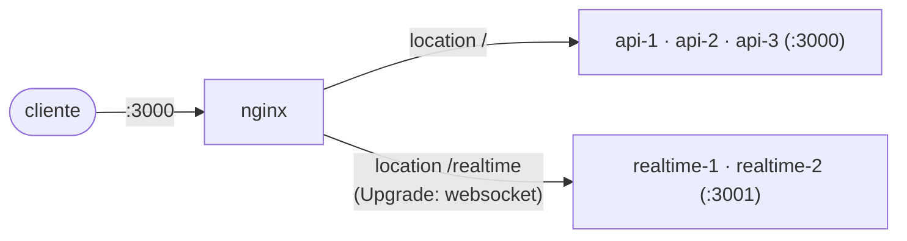

# nginx

Balanceador das 3 instâncias da `api` e das 2 do `realtime` no Compose de dev (D7.4, D28.9). É a única porta para fora (`localhost:3000`): os `curl` do §9 e o WebSocket em `ws://localhost:3000/realtime`.

| Arquivo | O que é |
|---|---|
| `nginx.conf` | Os `upstream` `api` (`api-1..3`) e `realtime` (`realtime-1..2`), os prazos, a regra de repetição e o upgrade para WebSocket. |

## Regras

- **Versão exata da imagem: `nginx:1.27.5-alpine`.** Os `upstream` usam `server api-N:3000 resolve` (e `realtime-N:3001 resolve`), para que uma instância reiniciada com outro IP volte a receber tráfego (DNS do Docker, `resolver 127.0.0.11`). O parâmetro `resolve` no `upstream` só existe no nginx open source **a partir da 1.27.3**. Conferido em 01/11/2026: com a 1.27.2, o `nginx -t` falha com `invalid parameter "resolve"`; com a 1.27.5, passa. Uma tag flutuante (`1.27-alpine`) funcionaria hoje, mas não fixa esse mínimo. O teste `test/integration/infra/compose-topology.spec.ts` exige uma versão exata ≥ 1.27.3.
- **Não roteia pela readiness** (D5, B7.7): o tráfego continua com o SQS fora.
- **Só repete o que não chegou à api** (`proxy_next_upstream error`, sem `non_idempotent`): um `POST` que já chegou nunca é repetido pelo nginx. Quem reenvia é o provedor, com a mesma `Idempotency-Key` (D3.4).
- **Prazo de leitura de 15 s**, acima dos 10 s da requisição na api (D21.3): o `503` da api chega antes do `504` do nginx.
- **`worker_connections 4096`** (D26.10). O teste de carga encontrou o teto do padrão, 512: a 400 req/s (cenário A) e na hot wallet a 100 req/s (cenário B), o nginx respondeu `500` sem corpo da api ("512 worker_connections are not enough while connecting to upstream"). Foram 9 294 respostas no A 400/s e 1 543 linhas logadas no B 100/s. Sem keepalive no upstream, cada requisição em andamento ocupa 2 conexões, então o teto era de ~256 requisições simultâneas. Com 4096, são ~2048, acima das 1 200 conexões do maior passo do k6 (600 VUs).
- **WebSocket em `/realtime`** (D28.9). O upgrade não passa sem os dois headers: `proxy_http_version 1.1`, `Upgrade $http_upgrade` e `Connection $connection_upgrade` (o `map` manda `upgrade` quando o cliente pede e `close` quando não pede). **Prazo de leitura de 75 s**, acima do `ping` de 30 s do realtime: com os 60 s padrão e sem ping, o nginx derrubaria uma conexão ociosa. **`proxy_next_upstream error timeout`**: o handshake é um `GET` sem efeito, então repetir em outra instância é seguro (ao contrário do `POST` da api). Uma instância parando fecha os sockets com `1001`, e o cliente reconecta pela mesma porta, caindo na outra. O `location /` da api não muda (continua com `Connection ""`, sem upgrade). Testado em `test/integration/infra/compose-topology.spec.ts`.
- **Sem keepalive no upstream, de propósito** (D26.10). Reaproveitar as conexões nginx → api pouparia o handshake TCP a cada requisição, mas cria um modo de falha novo: se a api fechar uma conexão ociosa no mesmo instante em que o nginx a reaproveita para um `POST`, o nginx não repete o `POST` (não é idempotente) e devolve `502` ao provedor. Evitar isso exige alinhar o timeout de keepalive do nginx (`keepalive_timeout` do upstream) abaixo do do servidor HTTP da api, e testar a corrida. Fica como melhoria possível.
