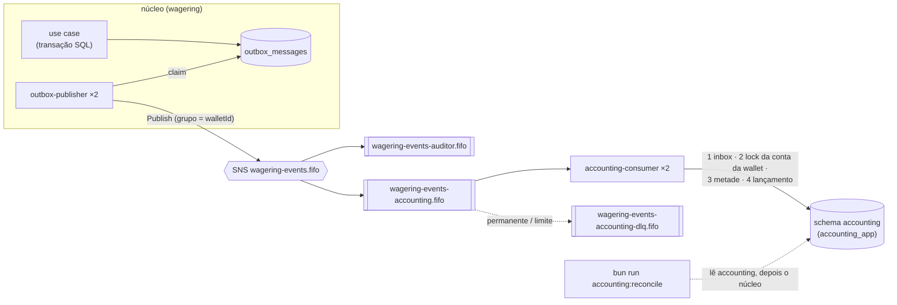

# Contexto `accounting`: partidas dobradas

O diferencial opcional do §6.4 (L313): um diário de **partidas dobradas** (*double-entry bookkeeping*), mantido por um serviço separado que só conversa com o núcleo por eventos (D12.1, D12.2, D27). O núcleo (`src/modules/wagering/`) não muda: nenhum arquivo, nenhuma tabela, nenhuma transação dele.

## Fluxo



Cada transação que muda o saldo gera, no mesmo commit do núcleo, um `WagerTransactionProcessed` (com o `kind`) e um `WalletBalanceChanged` (com a direção e os saldos), ambos com o mesmo `transactionId` e a mesma `walletVersion` (D9.4, D6.2). O `WalletBalanceChanged` do §11 não traz o `kind`, e só pela direção não dá para escolher a conta da casa. Por isso o consumidor grava cada evento como uma **metade** e lança quando a segunda chega, em qualquer ordem (D27.1).

| Evento | O que acontece |
|---|---|
| `WalletBalanceChanged` | metade gravada; lançamento se a outra já chegou |
| `WagerTransactionProcessed` com `walletVersion` | metade gravada; lançamento se a outra já chegou |
| `WagerTransactionProcessed` sem `walletVersion` (`LOSS`) | ack, sem tocar no banco |
| qualquer outro `eventType` com envelope válido | ack, sem tocar no banco |

## Plano de contas (D27.2)

Cada conta existe por moeda.

| Conta | Natureza | Saldo |
|---|---|---|
| `PLAYER_WALLET` (uma por wallet) | passivo da casa com o jogador | créditos − débitos = saldo da wallet |
| `HOUSE_OPENING_FUNDS` | ativo (fundos da abertura) | devedor |
| `HOUSE_WAGERS_RECEIVED` | receita (apostas recebidas) | credor |
| `HOUSE_PAYOUTS` | despesa (prêmios pagos) | devedor |
| `HOUSE_REFUNDS` | redutora de receita (estornos) | devedor |
| `HOUSE_ROLLBACKS` | ajustes por rollback | qualquer |

| `kind` + direção na wallet | Débito | Crédito |
|---|---|---|
| `OPENING` + CREDIT | `HOUSE_OPENING_FUNDS` | `PLAYER_WALLET` |
| `BET` + DEBIT | `PLAYER_WALLET` | `HOUSE_WAGERS_RECEIVED` |
| `WIN` + CREDIT | `HOUSE_PAYOUTS` | `PLAYER_WALLET` |
| `REFUND` + CREDIT | `HOUSE_REFUNDS` | `PLAYER_WALLET` |
| `ROLLBACK` + CREDIT (desfaz `BET`) | `HOUSE_ROLLBACKS` | `PLAYER_WALLET` |
| `ROLLBACK` + DEBIT (desfaz `WIN` ou `REFUND`, D1.2) | `PLAYER_WALLET` | `HOUSE_ROLLBACKS` |

Qualquer outra combinação (`BET` com crédito, `WIN` com débito, `LOSS`, valor 0) é permanente e vai para a DLQ. O valor 0 numa metade é recusado já na leitura do evento (zod), sem tentativa contada; um `LOSS` sem `walletVersion` continua aceitando 0, porque não é metade. Todo lançamento tem 2 linhas, uma moeda e exatamente uma linha de `PLAYER_WALLET`, na direção do `WalletBalanceChanged`. A linha da wallet repete o ledger do núcleo, então o saldo da conta reproduz o saldo da wallet. Wallet aberta com saldo zero não tem `OPENING` (D2.3) nem lançamento.

**Exemplo** (wallet de 100.00, `BET` de 30.00, `REFUND` dela, `WIN` de 15.00, `ROLLBACK` do `WIN`):

| Versão | Débito | Crédito | Saldo da `PLAYER_WALLET` |
|---|---|---|---|
| 1 `OPENING` | `HOUSE_OPENING_FUNDS` 100.00 | `PLAYER_WALLET` 100.00 | 100.00 |
| 2 `BET` | `PLAYER_WALLET` 30.00 | `HOUSE_WAGERS_RECEIVED` 30.00 | 70.00 |
| 3 `REFUND` | `HOUSE_REFUNDS` 30.00 | `PLAYER_WALLET` 30.00 | 100.00 |
| 4 `WIN` | `HOUSE_PAYOUTS` 15.00 | `PLAYER_WALLET` 15.00 | 115.00 |
| 5 `ROLLBACK` | `PLAYER_WALLET` 15.00 | `HOUSE_ROLLBACKS` 15.00 | 100.00 |

Σ débitos = Σ créditos = 190.00.

**Alternativas descartadas** (D27.2): "apostas em aberto" (nada a fecha: o `LOSS` não muda saldo e pode valer 0, e há `WIN` sem `BET`, D1.6); `ROLLBACK` na conta de origem (dependeria do lançamento da referência, uma dependência de ordem).

## Camadas

| Camada | Arquivos | Regra |
|---|---|---|
| `domain/` | `amount.ts` (centavos `bigint`), `chart-of-accounts.ts`, `journal-entry.ts` (imutável, `post` + `isBalanced`), `accounting-reconciliation.ts` (função pura) | TypeScript puro; sem `Number`, `Math` e afins (D2) |
| `application/` | `record-event-half.use-case.ts`, `ports.ts`, `envelope-hash.ts`, `errors.ts` | sem ORM, AWS, pino, `infra/` nem o núcleo |
| `infra/` | `messaging/` (parser e consumidor), `persistence/` (SQL direto, sem entidades), `accounting-config.ts`, `accounting-consumer.module.ts` | do núcleo, só o laço genérico (abaixo) |

**Fronteira com o núcleo (D27.8).** O accounting importa do núcleo **só** `wagering/infra/messaging/{sqs-consumer,sqs-wager-queue,consumer-policy}` e `wagering/infra/observability/gauges`: o laço SQS genérico da D20.2, que também roda o auditor, com a mesma taxonomia de erros, DLQ, tentativas, ordem no grupo e `stop()`. O lint (`noRestrictedImports` por camada, em `biome.json`) e o `test/unit/accounting/boundaries.spec.ts` garantem isso; o núcleo nunca importa o accounting. O `Amount`, o hash canônico e a persistência das tentativas são próprios do contexto. **Dívida técnica:** mover o laço genérico para `src/shared/messaging/`. Agora isso mudaria arquivos do núcleo e os patches das provas.

## Garantias no banco (D27.3)

Schema `accounting` (migration `Migration20261108000013_accounting`), dono `wagering_owner`, papel `accounting_app`.

| Garantia | Como |
|---|---|
| Débito = crédito, ≥ 2 linhas, uma linha da conta da wallet | constraint triggers `DEFERRABLE INITIALLY DEFERRED` em `journal_entries` e `journal_lines` (`journal_entries_balanced`, `journal_entries_player_line`), no COMMIT |
| Append-only | triggers `BEFORE UPDATE OR DELETE` e `BEFORE TRUNCATE` em `accounts`, `received_events`, `journal_entries`, `journal_lines`, que valem até para o dono; o `accounting_app` só tem `SELECT, INSERT` (mais `UPDATE (id)` em `accounts`, que o `SELECT … FOR UPDATE` exige e o trigger recusa) |
| Uma vez por evento | inbox por `(consumer_name, event_id)`; `received_events` único por `event_id` e por `(transaction_id, event_type)`; `journal_entries` único por `transaction_id`, por `(wallet_id, wallet_version)`, por `balance_event_id` e por `processed_event_id` |
| Dinheiro | `numeric(20,2)` com `CHECK > 0`, `char(3)`; nunca `number` na aplicação (strings decimais e centavos `bigint`) |
| Moeda coerente | FKs `(entry_id, currency)` e `(account_id, currency)` |
| Isolamento | o `accounting_app` não tem `USAGE` no `public`; o `wagering_app` não tem nada no `accounting` |

O papel nasce no `scripts/postgres-init.sh` (o dono é `NOCREATEROLE`), que só roda num volume novo: num ambiente existente, recrie o volume do Postgres uma vez (`docker compose down -v`, D27.9). A migration falha com mensagem clara se o papel não existir.

## Concorrência (D27.4)

Ordem de locks, numa transação `READ COMMITTED`:
1. chave da inbox (`INSERT … ON CONFLICT DO NOTHING`, o 1º comando);
2. a linha da conta `PLAYER_WALLET` da wallet (`INSERT … ON CONFLICT DO NOTHING` + `SELECT … FOR UPDATE`), o equivalente ao lock da wallet do núcleo;
3. sob esse lock: outra metade do mesmo tipo para a transação → conflito; grava a metade; se a outra existe, confere o par (wallet, valor, moeda, versão, `balanceAfter`) e grava o lançamento.

Duas metades do mesmo par em duas instâncias ao mesmo tempo esperam no lock da conta: a segunda vê a primeira e lança. Lançar é **comutativo**: versões fora de ordem mudam só a ordem das linhas, nunca a soma.

## Erros (D27.5)

A taxonomia da D20.2, com `consumer_name = accounting-consumer`:

| Situação | Destino |
|---|---|
| envelope ou `data` inválidos; mesmo `eventId` com outro conteúdo; outra metade do mesmo tipo para a transação; par incoerente; `kind` e direção sem lançamento; moeda diferente da conta | permanente: cópia intacta para `wagering-events-accounting-dlq.fifo` |
| banco fora, `lock_timeout`, erro interno | retry contado em `accounting.message_attempts` (limite 8), DLQ no limite, tentativas apagadas no ack e na DLQ (D19.11) |
| redrive da fila (`maxReceiveCount = 20`) | rede de segurança quando nem contar nem copiar funciona |

Métricas: `accounting_entries_posted_total`, `wagering_retries_total{component="accounting_consumer"}`, `wagering_dlq_messages_total{consumer="accounting"}`, `sqs_dlq_depth{queue="accounting_dlq"}`. Logs só com ids, tipo do evento e versão (D11.1).

## Reconciliação (D27.7)

```bash
bun run accounting:reconcile                         # todas as wallets
bun run accounting:reconcile --player-prefix load-   # só as de um prefixo de playerId
bun run accounting:reconcile --wait 120              # espera o diário alcançar o núcleo
```

Roda num container da imagem da app, na rede do Compose de dev (`docker compose run`, `DB_HOST=postgres`): não depende da porta 5432 do host, que numa máquina com um Postgres nativo responde por outro servidor. Com código novo, `bun run infra:up` reconstrói a imagem antes (D23.8). Lê o accounting com o `accounting_app` e, **depois**, o núcleo com o `wagering_app`: o diário só pode estar atrás do núcleo. Só reporta, nunca corrige (D6.9). A saída tem contagens, ids e códigos, nunca valores.

| Estado da wallet | Quando |
|---|---|
| consistente | última versão lançada = `version` do núcleo e saldo igual; ou nenhum lançamento, versão 1 e saldo 0 |
| atrasada (`EVENTS_PENDING`) | versão lançada < `version`, ou buraco na sequência: eventos ainda não consumidos, não é divergência |
| divergente | saldo diferente na mesma versão (`CORE_BALANCE_MISMATCH`), versão à frente (`VERSION_AHEAD`), continuidade quebrada (`CHAIN_BROKEN`), saldo da conta ≠ último `balanceAfter` (`ACCOUNT_BALANCE_MISMATCH`), wallet que o núcleo não tem, moeda diferente |

E, no diário inteiro, **Σ débitos − Σ créditos = 0** em cada moeda. Sai com 1 se houver divergência ou trial balance ≠ 0, e, com `--wait`, se o prazo acabar com wallet atrasada ou par incompleto. No CI, roda depois da aceitação, no job `acceptance` (D27.7).

## Processo

`accounting-consumer` ×2 no Compose de dev (`src/entrypoints/main-accounting-consumer.ts`), conectando com `DB_USER=accounting_app`. Config própria: `QUEUE_ACCOUNTING_EVENTS`, `QUEUE_ACCOUNTING_EVENTS_DLQ` (`infra/accounting-config.ts`). `SIGTERM`: o `stop()` do laço genérico (D8.5, D19.9).

## Limitações

- **Consistência eventual:** o diário fica atrás do núcleo enquanto os eventos não foram consumidos; a reconciliação mostra isso como "atrasada", não como erro.
- **Sem backfill:** o accounting só vê os eventos publicados depois de a fila dele existir. Com o LocalStack sem persistência, cada `infra:up` recria a fila; wallets de antes aparecem como atrasadas.
- **Par incompleto só na reconciliação:** se uma metade nunca chegar (o publisher nunca descarta, D9.6, então só por um bug), o par fica sem lançamento e aparece como `incompletePairs`.
- **Vazão:** cada evento é uma transação com fsync, como no auditor (D26.13); com o volume do teste de carga, o diário atrasa sem afetar o núcleo.

## Testes

| O quê | Onde |
|---|---|
| cada `kind` vira o lançamento certo, sempre balanceado (fast-check); `Amount`; reconciliação; parser | `test/unit/accounting/` |
| fronteira com o núcleo (lint e imports) | `test/unit/accounting/boundaries.spec.ts` |
| garantias do banco (balanceamento diferido, append-only, unicidades, tipos, papéis) | `test/integration/accounting/schema.spec.ts` |
| consumidor: par em qualquer ordem, versões fora de ordem, duplicata, DLQ, retry contado | `test/integration/accounting/consumer.spec.ts` |
| do núcleo ao diário, com reconciliação | `test/integration/accounting/end-to-end.spec.ts` |
| duas instâncias no mesmo evento e no mesmo par; carga com 2 publishers e 2 consumidores em processos separados | `test/concurrency/accounting.spec.ts` |
| SIGTERM real (fora do Windows; no CI) | `test/integration/shutdown/accounting-sigterm.spec.ts` |
| provas 15 a 17 | [`proofs/README.md`](../../../proofs/README.md) |
