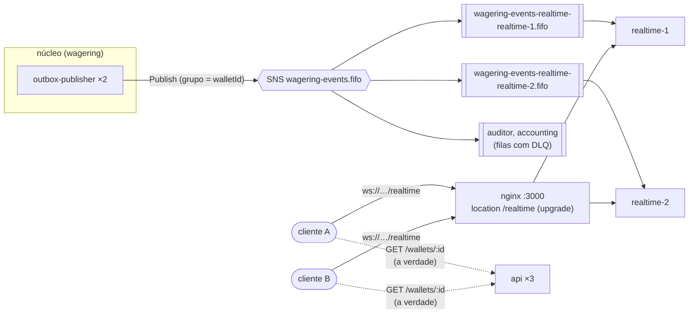
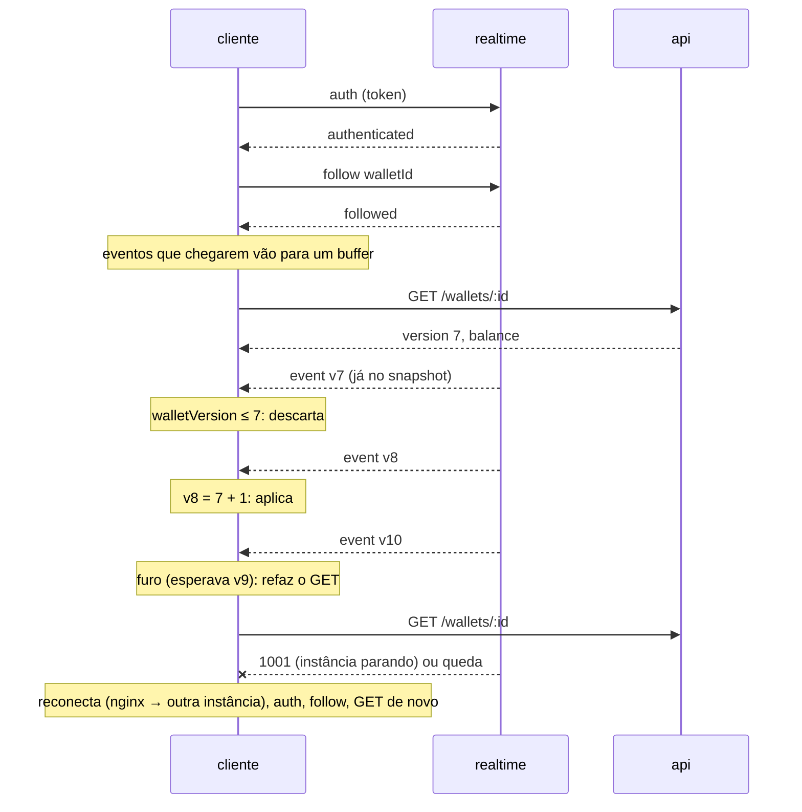

# Contexto `realtime`: WebSocket de tempo real

Notificações por WebSocket dos eventos de uma wallet (V-01, V-03 da vaga; não está no enunciado), num serviço separado que só recebe eventos do tópico SNS (D12.2, D12.4, D28). **O WebSocket é notificação, não fonte da verdade:** a verdade é o `GET /wallets/:id` (e o ledger). O núcleo (`src/modules/wagering/`) não muda: nenhum arquivo, nenhuma tabela, nenhum teste dele. O realtime não usa banco e não chama a api.

## Fluxo



**Uma fila por instância (D28.5).** Numa fila comum, cada evento iria para uma instância só, e o cliente conectado na outra não receberia. Cada instância tem um id estável (`REALTIME_INSTANCE_ID`: `realtime-1`, `realtime-2`) e a fila `wagering-events-realtime-<id>.fifo` (FIFO, retenção de 300 s, visibilidade de 30 s, sem DLQ). **A fila e a assinatura são da infra** (`scripts/localstack-init.sh`), como as do auditor e do accounting: o realtime só usa SQS e nunca toca no SNS, que fica só no publisher (D20.10). Sem a fila, a subida falha com uma mensagem que aponta o init.

**Laço (D28.7).** Sequencial por instância, então a ordem do FIFO por `walletId` chega igual aos sockets. Para cada mensagem: descarte por idade, parse pela lista fechada, envio aos sockets locais que seguem a wallet e podem ver o evento, e delete. **Sem inbox, sem tentativas e sem DLQ**, uma exceção explícita à regra da DLQ: o evento já está guardado na outbox e nas filas com DLQ do auditor e do accounting, e a fila do realtime é notificação efêmera.

**Descarte por idade (D28.6).** Na subida, a instância guarda o horário de início antes de resolver a fila. A mensagem com `SentTimestamp` anterior a ele é apagada sem ser enviada (`realtime_events_total{outcome="stale"}`): o que ficou na fila enquanto a instância estava fora não chega a ninguém. Sem `PurgeQueue`, que é assíncrono (até 60 s, podendo apagar mensagens novas) e falha numa 2ª chamada em menos de 60 s.

## Protocolo (D28.2)

`ws://localhost:3000/realtime`, JSON, uma mensagem por frame (até 4 KB).

| Direção | Mensagem |
|---|---|
| cliente → | `{"type":"auth","token":"<JWT>"}`: **1º frame**, em até 5 s |
| cliente → | `{"type":"follow","walletId":"<uuid>"}` · `{"type":"unfollow","walletId":"<uuid>"}` (até 50 por conexão) |
| ← servidor | `{"type":"authenticated","roles":["operator"]}` |
| ← servidor | `{"type":"followed","walletId"}` · `{"type":"unfollowed","walletId"}` |
| ← servidor | `{"type":"event",…}` (abaixo) |
| ← servidor | `{"type":"error","code":"VALIDATION_ERROR"}` · `{"type":"error","code":"FOLLOW_LIMIT","walletId"}` |

O token vai no 1º frame, e não no header nem na query string: o `WebSocket` do navegador não manda `Authorization`, e a query string iria para o access log do nginx (D11). É validado pelo mesmo `JoseProviderIdentity` da api (JWKS, emissor, audiência, `exp`, RS256, papéis da D16.1). Não existe chave para desligar a autenticação (D10.3).

| Código de fechamento | Quando | Reconectar resolve? |
|---|---|---|
| `4400` | protocolo violado antes do `auth` (outro `type`, JSON quebrado, frame binário) | não |
| `4401` | token ausente, inválido, sem papel, ou que **venceu durante a conexão** | com outro token |
| `4408` | o `auth` não chegou em 5 s | sim |
| `4503` | JWKS do emissor indisponível (D16.16) | sim |
| `1001` | o processo está parando (SIGTERM) | sim, em outra instância |
| `1009` | frame acima de 4 KB | não |
| `1011` | erro inesperado do servidor | sim |
| `1013` | cliente lento (mais de 1 MB esperando envio) | sim |

Depois do `auth`, um frame inválido não fecha a conexão: responde `error`. `ping` a cada 30 s; sem `pong` até o ping seguinte, a conexão é encerrada.

## Quem vê o quê (D28.3, D10.2)

As mesmas permissões das consultas HTTP: o WebSocket não mostra nada que o GET não mostraria ao mesmo token.

| Evento | `operator` | `provider` |
|---|---|---|
| `WalletBalanceChanged`, `WalletOpened` | ✓ | ✓ (consultar wallet é aberto aos dois) |
| `WagerTransaction*` | todos | só os do próprio `providerId` |
| `WagerTransactionProcessed` da `OPENING` (`providerId` nulo) | ✓ | ✗ |

Qualquer token válido segue qualquer wallet. O realtime não tem banco, então não confere se a wallet existe: uma wallet inexistente só não recebe nada, e o cliente descobre o `404` no GET.

## Eventos (D28.4)

```json
{
  "type": "event",
  "eventId": "…",
  "eventType": "WalletBalanceChanged",
  "occurredAt": "2026-11-08T12:00:00.000Z",
  "walletId": "0192f291-27dd-7d3f-8071-5f8685deef37",
  "walletVersion": 2,
  "data": {
    "transactionId": "…",
    "direction": "DEBIT",
    "money": { "amount": "25.00", "currency": "BRL" },
    "balanceBefore": { "amount": "1000.00", "currency": "BRL" },
    "balanceAfter": { "amount": "975.00", "currency": "BRL" }
  }
}
```

| `eventType` | `data` | `walletVersion` |
|---|---|---|
| `WalletBalanceChanged` | `transactionId`, `direction`, `money`, `balanceBefore`, `balanceAfter` | sempre |
| `WalletOpened` | `currency`, `initialBalance` | sempre (1) |
| `WagerTransactionProcessed` | `transactionId`, `providerId`, `externalTransactionId`, `kind`, `status: "PROCESSED"`, `money`, `referenceTransactionId?`, `balanceAfter` | quando o saldo mudou (não na `LOSS`) |
| `WagerTransactionRejected` | os ids, `kind`, `status: "REJECTED"`, `money`, `failureCode` | `null` |
| `WagerTransactionPendingReference` | os ids, `kind`, `status: "PENDING_REFERENCE"`, `referenceExternalTransactionId` | `null` |
| `WagerTransactionFailed` | os ids, `kind`, `status: "FAILED"`, `money`, `failureCode` | `null` |

**Lista fechada:** ficam de fora `playerId`, `roundId`, `gameId`, `correlationId`, `causationId` e `aggregateId`. Um campo que o núcleo acrescentar não vaza sozinho, e um `eventType` fora da lista é ignorado. Os valores chegam como estão (string de 2 casas + moeda, D2): o realtime não faz conta.

## Garantia de entrega e reconexão (D28.8)

Melhor esforço, em ordem por wallet dentro de uma conexão, com duplicata possível (um delete que falhou) e perda enquanto o cliente está fora. O cliente corrige isso com o GET e a `walletVersion`:



A regra está em `domain/wallet-view.ts` (`WalletView`), usada pelo `bun run realtime:watch`: um evento da wallet com a versão seguinte é aplicado; com versão já contida, descartado; com furo, pede um novo GET. Os eventos de transação são aplicados uma vez (pelo `eventId`), salvo os que o snapshot já contém.

## Demo: `bun run realtime:watch <walletId>` (D28.13)

Com o Compose de dev de pé (`bun run infra:up`):

```bash
bun run realtime:watch 0192f291-27dd-7d3f-8071-5f8685deef37
```

Ele pega um token `operator` no Keycloak, segue a wallet, faz o GET inicial e imprime uma linha por evento, reconectando sozinho (o token de 5 min vence → `4401` → token novo). Num outro terminal, os `curl` do §9 ([`README.md`](../../../README.md#9-submeter-transação)) fazem o saldo mudar ao vivo:

```text
22:24:15.234  seguindo a wallet 0192f291-27dd-7d3f-8071-5f8685deef37 em ws://localhost:3000/realtime
22:24:15.299  GET /wallets: v1, saldo 1000.00 BRL (a verdade; o WebSocket só notifica)
22:24:25.377      transação  BET      REJECTED          25.00 BRL demo-1794176664 (WALLET_PLAYER_MISMATCH)
22:24:37.482  v2  transação  BET      PROCESSED         25.00 BRL demo-1794176677
22:24:37.483  v2  saldo  DEBIT       25.00 BRL  →  975.00 BRL
```

Opções: `--client provider-a` (vê só as transações dele), `--url`, `--api`, `--keycloak`; para o CI, `--exit-after <n>` e `--timeout <s>`. O token nunca é impresso.

## Processo e operação (D28.11)

- `realtime-1` e `realtime-2` no Compose de dev, mesma imagem, `stop_grace_period: 30s`, sem `ports` (só pelo nginx). Não esperam o Postgres nem o `migrate`.
- **Config própria e mínima** (`infra/realtime-config.ts`): `AWS_REGION`, `AWS_ENDPOINT`, `METRICS_PORT`, `AUTH_ISSUER`, `AUTH_AUDIENCE`, `AUTH_JWKS_URL`, `AUTH_JWKS_TIMEOUT_MS`, `REALTIME_INSTANCE_ID`, `REALTIME_PORT` (3001) e, opcionais, `REALTIME_AUTH_TIMEOUT_MS` (5000), `REALTIME_MAX_FOLLOWS` (50), `REALTIME_PING_INTERVAL_MS` (30000), `REALTIME_RECEIVE_WAIT_S` (20). **Sem credencial de banco.**
- **SIGTERM:** fecha os sockets com `1001`, deixa o long poll em andamento terminar (sem abortar, como a D19.9; o que ele trouxer é apagado sem envio) e sai. A fila e a assinatura ficam: a volta da mesma instância as reaproveita.
- **Métricas** (`/metrics`, porta interna, D22.1): `realtime_connections` e `realtime_events_total{outcome}` (`forwarded`, `ignored`, `invalid`, `stale`).
- **Logs:** só ids, códigos de fechamento e contagens; nunca token, valores, saldos nem `playerId` (D11.1).
- **NestJS no Bun (D28.10):** `@nestjs/websockets` + `@nestjs/platform-ws` (`WsAdapter`, WebSocket puro), provado por `test/integration/realtime/ws-adapter.spec.ts`. O gateway não usa `@SubscribeMessage`: cada conexão é uma `ConnectionSession`, que responde pelo `send` no formato `{type}` (o retorno de um handler sairia embrulhado em `{event, data}`).

## Camadas e fronteira (D28.1)

| Pasta | O que tem |
|---|---|
| `domain/` | `RealtimeEvent`, `canSee` (permissões), `WalletView` (contrato do cliente), códigos de fechamento. TypeScript puro |
| `application/` | `RealtimeHub`: quem segue qual wallet nesta instância, e a entrega a quem pode ver |
| `infra/messaging/` | schema próprio do envelope do §11 e projeção (`realtime-envelope.ts`), resolução da fila, laço da fila |
| `infra/ws/` | gateway, sessão de cada conexão, frames do cliente |
| `infra/realtime.module.ts` | montagem, subida e parada |

O realtime importa só `src/shared/*`; de `modules/wagering`, `modules/accounting` e `shared/orm`, nada. Nada do núcleo, do accounting ou do `shared` importa o realtime. Garantido pelo lint (`noRestrictedImports` por camada, em `biome.json`) e por `test/unit/realtime/boundaries.spec.ts`.

## Testes

| Teste | O que prova |
|---|---|
| `test/unit/realtime/*.spec.ts` | projeção por lista fechada, permissões, hub, `WalletView`, frames, config, fronteira |
| `test/integration/realtime/ws-adapter.spec.ts` | `WsAdapter` no Bun (D28.10) |
| `test/integration/realtime/realtime.spec.ts` | BET pelo HTTP → eventos no cliente; recusas (`4408`, `4401`, `4400`, `1009`, `4503`); expiração do token; frames inválidos e limite; isolamento entre wallets; permissões por provedor |
| `test/integration/realtime/instance-queue.spec.ts` | descarte por idade (antes da subida não chega, depois chega); subida sem fila falha; stop e `kill -9` mantêm fila e assinatura, a volta as reaproveita |
| `test/integration/realtime/processes.spec.ts` | duas instâncias em processos separados, cada cliente recebe na sua; logs sem dado sensível |
| `test/integration/realtime/localstack.spec.ts` | as filas do `localstack-init.sh` |
| `test/integration/shutdown/realtime-sigterm.spec.ts` | SIGTERM real: `1001` e saída em menos de 30 s (fora do Windows; o CI conta 7) |
| `test/concurrency/realtime.spec.ts` | 50 BETs em paralelo, 2 instâncias, 4 clientes: versões em ordem e sem furo |

## Limitações (D28.14)

- **Réplicas de nome dinâmico** (escala automática, Kubernetes) não têm id estável: seria preciso criar a fila e a assinatura na subida e varrer as órfãs, o que poria o SNS fora do publisher e pediria rever a D20.10. Uma 3ª instância fixa só precisa da fila dela na infra.
- **Dois processos com o mesmo id** dividem a fila, e cada um entrega metade dos eventos.
- **Relógios:** o descarte compara o `SentTimestamp` do SQS com o relógio da instância; uma diferença de relógio descarta ou deixa passar as mensagens da borda.
- **Permissão lida na conexão:** um token revogado continua valendo até o `exp`.
- **Morte durante o long poll:** depois de um `kill -9`, o receive que ficou aberto no servidor segura o que pegar pela visibilidade de 30 s; ao voltar, a instância descarta isso como velho.
