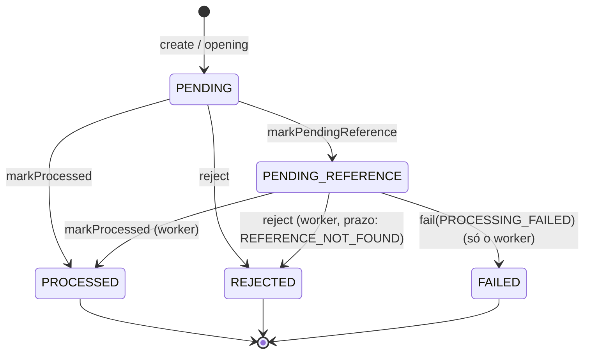

# wagering — domínio

TypeScript puro: dinheiro, wallet, ledger, transação de aposta, regras de cada kind e eventos de integração. Não importa framework, ORM, AWS, logger nem `zod` (o lint garante). A persistência (schema, garantias no banco, ORM) está em [`infra/persistence/README.md`](infra/persistence/README.md); os use cases, em [`application/README.md`](application/README.md); a API HTTP, em [`infra/http/README.md`](infra/http/README.md).

## Peças

| Arquivo (`domain/`)          | O que é                                                                                                                                                                                                                                    | Regras                                             |
| ---------------------------- | ------------------------------------------------------------------------------------------------------------------------------------------------------------------------------------------------------------------------------------------ | -------------------------------------------------- |
| `money.ts`                   | Centavos em `bigint` + moeda, imutável. `from` é a fábrica de entrada (sem sinal, 0 a 2 casas, até 12 dígitos inteiros); `rehydrate` lê o formato persistido (2 casas, com sinal). Nada é arredondado.                                     | R-06-10..18 · D2.1, D2.2, D2.4, D2.6, D14.7        |
| `wallet.ts`                  | Raiz de agregado. `open` nasce com `version` 1 e, se o saldo for positivo, devolve o lançamento da `OPENING`. `debit`/`credit` são o único jeito de mudar o saldo: sobem a `version` e devolvem o lançamento. Teto de 15 dígitos inteiros. | R-06-20..27 · D2.3, D2.4, D6.2, D6.5, D7.2         |
| `wallet-ledger-entry.ts`     | Lançamento congelado na construção. `create` valida aritmética, sinal, moeda e `walletVersion`.                                                                                                                                            | R-06-40..43                                        |
| `wager-transaction.ts`       | Agregado da transação: `create` (submissão; valida o que só depende do payload), `opening` (sem campos do provedor), transições, consultas.                                                                                                | R-06-30..39 · D1.5, D2.3, D4.5, D6.1, D14.5, D14.6 |
| `wager-transaction-rules.ts` | Serviço de domínio: `applyWagerTransaction` decide e aplica uma transação sobre a wallet travada; `openWallet` abre wallet + `OPENING`.                                                                                                    | R-07-* · D1, D5, D14.2, D14.3, D14.9               |
| `wallet-reconciliation.ts`   | `reconcileWallet`: Σ créditos − Σ débitos, encadeamento e cauda; devolve `consistent` e `issues` (`BALANCE_MISMATCH`, `CHAIN_BREAK`, `TAIL_MISMATCH`). Não corrige nada.                                                                    | R-09-18, R-09-19 · D6.9, D16.5                     |
| `failure-code.ts`            | `FailureCode` e `ReferenceScopeField`.                                                                                                                                                                                                     | D5, D14.1, D14.3                                   |
| `domain-error.ts`            | Erros lançados: payload inválido (vira `400`) ou erro de programação. Violação de regra de negócio **não** lança: vira `REJECTED`.                                                                                                         | D5                                                 |
| `events/`                    | `IntegrationEvent` abstrato e uma subclasse por evento, com `eventType` e `version` no tipo. `data` só com `MoneyProps`.                                                                                                                   | R-11-08..12 · D9.3, D9.4, D14.4                    |

A `version` da wallet sobe **só** dentro de `Wallet.debit`/`credit`. O mapeamento do ORM não a incrementa, e o banco recusa dois escritores com a mesma versão (D7.2, D15.7).

## Estados da transação

`PENDING` só existe em memória (D4.1). Os terminais não mudam: tentar é `InvalidTransactionStateError` (R-06-36).

- `markProcessed` grava `balanceAfter`, `processedAt` e o id interno da referência (obrigatório se e só se há referência externa).
- `reject` grava `failureCode` e `balanceAfter`; `failureDetail` vem só e sempre com `REFERENCE_SCOPE_MISMATCH`. `PROCESSING_FAILED` é exclusivo do `fail`.
- Uma pendente reavaliada sem referência continua pendente **sem** nova transição (`transitioned: false`), então não há evento repetido (D4.6).

## Como uma transação é decidida

`applyWagerTransaction` recebe a wallet (travada pelo use case), a transação e o resultado da busca da referência, que o repositório faz por `(providerId, referenceExternalTransactionId)`: `{ found: false }` ou `{ found: true, transaction, alreadyReversed }`. A ordem das checagens é a da **D14.2**: a primeira violação vence.

Interpretações documentadas (R-07-15):
- `WIN`/`LOSS` podem referenciar só uma `BET`, e não conferem valor. São aceitos mesmo depois de um `REFUND` da mesma `BET` (D1.6, D14.9).
- Uma referência é revertida no máximo uma vez, por qualquer tipo. Só uma reversão `PROCESSED` bloqueia outra (D1.1, D1.3).
- `ROLLBACK` de `REFUND` debita. Cadeia máxima: `BET ← REFUND ← ROLLBACK` (D1.2).
- Reversão sem saldo usa `INSUFFICIENT_FUNDS_FOR_REVERSAL`, distinto da `BET` sem saldo (R-07-14).
- Referência `REJECTED`/`FAILED` → `REFERENCE_NOT_PROCESSED` na hora; referência pendente → a transação espera (D1.4).
- Referência de outro provedor não é encontrada (a busca é por provedor) → `PENDING_REFERENCE` (R-07-07).

## Testes

`test/unit/domain/`, todos com o ID no nome. Os que movem dinheiro terminam com `expectLedgerMatchesBalances()` (`test/support/ledger-invariant.ts`).

| Arquivo                           | Prova                                                                                                                                 |
| --------------------------------- | ------------------------------------------------------------------------------------------------------------------------------------- |
| `money.spec.ts`                   | formato de entrada, sem arredondamento, moeda, imutabilidade; propriedades de soma e ida e volta (R-13-U1)                            |
| `wallet.spec.ts`                  | `open`, `debit`, `credit`, teto; propriedade: qualquer sequência mantém saldo = Σ lançamentos (R-13-U2)                               |
| `wallet-ledger-entry.spec.ts`     | aritmética validada, imutabilidade estrutural                                                                                         |
| `wager-transaction.spec.ts`       | validações do `create`, `opening`, tabela completa de transições, `matchesPayload` (R-13-U5)                                          |
| `wager-transaction-rules.spec.ts` | cada kind (R-13-U3), todos os casos da D1, escopo, conflito de moeda (R-13-U4), ordem da D14.2; propriedade com sequências aleatórias |
| `events.spec.ts`                  | envelope, `data` de cada evento, `aggregateId`                                                                                        |
| `failure-code.spec.ts`            | lista estável de códigos                                                                                                              |
| `wallet-reconciliation.spec.ts`   | cada divergência da D16.5, diferença com sinal, wallet sem lançamentos, não corrige                                                   |
| `../lint-domain-purity.spec.ts`   | domínio sem framework, sem `Number(`, `parseFloat`, `parseInt`, `Math.` e `toFixed` (D14.8)                                           |

`test/support/in-memory-book.ts` faz em memória o papel do repositório (busca da referência e `alreadyReversed`), para os testes de regra. O repositório real (S4) faz a mesma busca no Postgres, sob o lock da wallet: ver [`infra/persistence/README.md`](infra/persistence/README.md) e o fluxo da submissão em [`application/README.md`](application/README.md).
