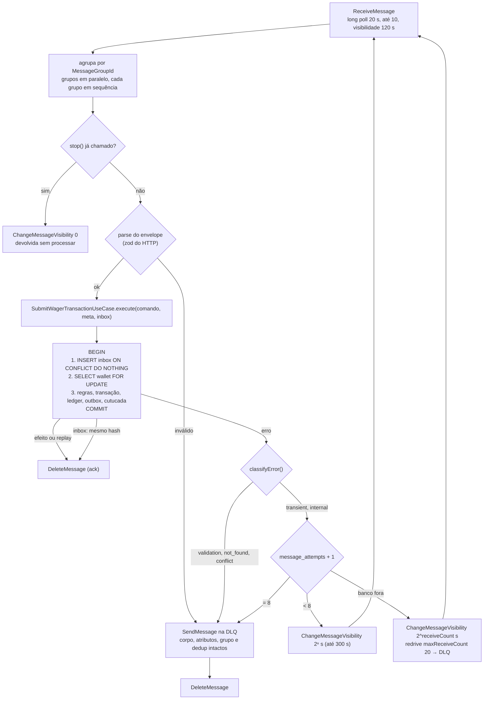

# wagering — consumidor SQS

Processo `consumer` (R-10-*, D8, D19). Lê a `wager-transactions.fifo` e chama **o mesmo** use case do HTTP, com a inbox (R-10-03, D19.4). Entrypoint: `src/entrypoints/main-consumer.ts`; módulo raiz: `src/app/consumer.module.ts` (sem HTTP). Quem produz na fila são os provedores; o sistema não publica nela (D8.1).

## Peças

| Arquivo | O que é | Regras |
|---|---|---|
| `wager-message.schema.ts` | Envelope do §10 → comando do use case. `messageId` = texto não vazio de até 255; `type` só `WagerTransactionRequested`; `occurredAt` ISO 8601; `data` = **o mesmo zod** do corpo HTTP mais o `idempotencyKey` (zod do header). Campos extras descartados, como no HTTP. JSON quebrado ou fora do schema → `ValidationError`. | R-10-02 · D3.8, D5, D19.5 |
| `consumer-policy.ts` | Valores (long poll 20 s, 10 por receive, visibilidade 120 s, limite 8, teto 300 s, prazo do `stop()` 20 s + 5 s) e funções puras: backoff 2ⁿ s, limite esgotado, destino de cada categoria de erro. | D8.2, D8.3, D8.5, D19.1, D19.2, D19.6, D19.9 |
| `sqs-wager-queue.ts` | Receive (com grupo, deduplicação, `ApproximateReceiveCount` e atributos), ack, visibilidade e a cópia para a DLQ: **envia e só depois apaga**. | R-10-01 · D8.2, D19.6, D19.9 |
| `wager-transactions-consumer.ts` | O laço, `pollOnce()` (um receive e o lote; é o que os testes usam), `start()`/`stop()`. | R-10-03..09 · D8, D19 |
| `consumer.module.ts` | Resolve as URLs das filas configuradas, liga o use case, o `message_attempts` e o laço; no shutdown, para o consumidor antes de o ORM fechar. | D7.4 |
| `../persistence/message-attempts.ts` | Upsert da tentativa em `message_attempts`, em autocommit (a transação do use case já foi desfeita). | D8.3 |

A inbox fica no use case, não aqui: `TransactionScope.inbox.register` (`INSERT … ON CONFLICT DO NOTHING`, com `processed_at = now()`) é o primeiro comando da transação, antes do lock da wallet. Detalhe em [`application/README.md`](../../application/README.md#pela-fila-r-10-03-r-10-04-d194).

## Ciclo de uma mensagem

| Resultado | O que acontece | Regra |
|---|---|---|
| Aplicada, `REJECTED`, `PENDING_REFERENCE` ou replay da key | commit, depois ack | R-10-05, R-10-06 · D8.2 |
| Mesmo `messageId`, mesmo hash (inbox) | ack sem efeito; `wagering_duplicates_total{layer="inbox"}` | R-10-09 · D3.7, D3.8, D19.4 |
| JSON quebrado, schema, `type` desconhecido, `OPENING`, wallet inexistente | DLQ na hora | D5, D8.2, D19.5 |
| Mesmo `messageId` com outro hash; `IDEMPOTENCY_KEY_CONFLICT`; `EXTERNAL_ID_CONFLICT` | DLQ na hora | D3.8, D19.1 |
| Transitório (banco fora, `lock_timeout`, conflito transitório da D17.6) ou interno (bug) | sem ack; `message_attempts + 1`; visibilidade 2ⁿ s até 300 s; na 8ª falha, DLQ | R-10-07 · D8.2, D8.3, D19.2 |
| Transitório **e** o `message_attempts` não grava (banco inalcançável) | sem ack; atraso 2ⁿ s pelo `ApproximateReceiveCount` (só o atraso); o limite é o redrive `maxReceiveCount = 20` da fila | D8.3, D19.3 |

## Garantias

- **Ack só depois do commit** (R-10-05): o `DeleteMessage` vem depois de o use case voltar. Se o processo morrer entre o commit e o ack, a reentrega passa pela inbox e não duplica (R-13-C5). Se o ack falhar, o resultado é `ack_failed` e a reentrega cai na inbox.
- **Inbox atômica com o efeito** (§11, D19.4): a linha só existe se o efeito commitou. Duas instâncias com a mesma mensagem: a segunda espera na chave da inbox da primeira (lock 1 da ordem) e, quando ela commita, vê a duplicata sem tocar na wallet.
- **Segunda barreira, a key** (D3.8): `messageId` diferente com a mesma key passa pela inbox e o use case devolve replay.
- **DLQ sem perda** (D19.6): envia para a DLQ e só depois apaga. Uma queda entre os dois deixa uma cópia a mais na DLQ; se o envio falha, nada é apagado. Nenhum atributo é acrescentado; o motivo vai para o log.
- **Tentativas contadas no banco** (D8.3), nunca pelo `ApproximateReceiveCount`, que também conta devoluções do `SIGTERM` e crashes.
- **Ordem por grupo** (D19.6): a visibilidade de 120 s cobre o pior caso de um lote de um grupo (10 × (2 s de `lock_timeout` + 5 s de `statement_timeout`) = 70 s, mais a repetição da D3.6). A correção não depende de ordem (D8.1).

## SIGTERM (R-10-08, D8.5, D19.9)

`stop()` não começa outro receive. O long poll em andamento **não é abortado**: ele termina (até 20 s), e tudo o que trouxer volta na hora com visibilidade 0, sem processar. Um lote em andamento termina a mensagem atual de cada grupo e devolve as não iniciadas. O prazo é 20 s, mais 5 s para devolver, dentro dos 30 s do Compose.

Por que não abortar: o abort fecha só a conexão do cliente. O `ReceiveMessage` continua aberto no servidor até completar, e o que chegar nesse intervalo é entregue a ninguém e fica invisível pelos 120 s da visibilidade.

**Limitação:** se o processo morrer à força (`SIGKILL`, crash) durante um long poll, as mensagens daquele receive ficam em voo até a visibilidade de 120 s vencer. Não há perda nem duplicação; só atraso.

O teste do sinal real (processo separado) é da S8; aqui, o `stop()` é testado direto (D19.7).

## Logs

`correlationId` e `messageId` (o do corpo, D9.5), `walletId` e `providerId` no contexto; a categoria e o código do erro; o número da tentativa. Nunca valores, saldos, payload nem `playerId` (D11.1).

## Testes

| Arquivo | Prova |
|---|---|
| `test/unit/messaging/wager-message.spec.ts` | a mensagem literal do §10; `"25"` normalizado; `messageId` livre até 255; campos extras descartados; JSON quebrado, `type`, `occurredAt`, `idempotencyKey`, `OPENING`, moeda, 3 casas, formato do `providerId` |
| `test/unit/messaging/consumer-policy.spec.ts` | backoff 2ⁿ até 300 s; limite 8; valores da D19.6; prazo do `stop()` dentro dos 30 s (D19.9); destino de cada categoria (D19.1, D19.2) |
| `test/unit/messaging/sqs-wager-queue.spec.ts` | DLQ: envia antes de apagar; envio falhou → não apaga; corpo, atributos, grupo e dedup intactos; SHA-256 do corpo sem dedup original; receive e visibilidade |
| `test/unit/application/submit-inbox.spec.ts` | inbox antes do lock, sem checagem rápida; hash da inbox; duplicata sem lock, contada em `inbox`; conflito → `InboxConflictError`; HTTP sem inbox |
| `test/integration/messaging/consumer.spec.ts` | §10 literal com só `MessageGroupId`; mesma mensagem duas vezes → um efeito; mesmo `messageId` com outro `occurredAt` → duplicata, com outro payload → DLQ; outro `messageId` com a mesma key → replay; HTTP e depois fila → replay (R-10-03); `REJECTED` e `PENDING_REFERENCE` → ack; JSON, `type`, `OPENING`, wallet inexistente, conflito de key e de id externo → DLQ intacta; wallet travada → tentativas e DLQ no limite; backoff de 2 s (não 120 s); banco inalcançável → redrive; commit que falha → sem ack, nada gravado; `stop()` no meio do lote; `stop()` durante um long poll vazio não prende a mensagem (falha com o abort antigo, D19.9); o `ConsumerAppModule` consome a fila configurada |
| `test/concurrency/consumer.spec.ts` | R-13-C5: `DeleteMessage` que nunca chega (morto entre o commit e o ack) → a reentrega vai para outra instância, que vê a inbox; a mesma mensagem em 3 instâncias → um efeito, as duas duplicatas esperando a chave da inbox (`pg_locks`) |

`test/support/sqs.ts` cria um par de filas FIFO por teste, com os atributos do init (D19.8). `test/support/consumer.ts` monta um consumidor sobre um MikroORM próprio (duas chamadas = duas instâncias), com falhas injetáveis na unidade de trabalho e no cliente SQS.
