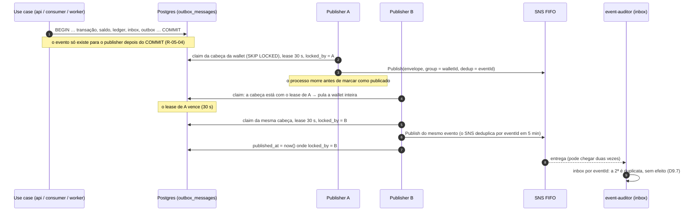

# wagering — publisher da outbox

Processo `outbox-publisher` (R-11-02, R-11-03, D9, D20). Lê `outbox_messages` e publica cada evento no tópico SNS FIFO `wagering-events.fifo`. Os use cases nunca publicam: eles gravam a outbox na mesma transação do efeito (R-11-01, R-05-04). Entrypoint: `src/entrypoints/main-outbox-publisher.ts`; módulo raiz: `src/app/outbox-publisher.module.ts` (sem HTTP).

## Peças

| Arquivo | O que é | Regras |
|---|---|---|
| `outbox-policy.ts` | Valores (lote de 50 cabeças, lease de 30 s, espera de 500 ms depois de um claim vazio, teto de 300 s, alerta a partir de 20 tentativas) e funções puras: backoff 2ⁿ s e "passou do limite". | D9.6, D20.3, D20.4 |
| `outbox-publisher.ts` | O laço (`runOnce`, `start`, `stop`): claim, publicação do lote em paralelo, marcação só do que o SNS confirmou, falha gravada com backoff. Nunca descarta. | R-11-02 · D9.6, D20.3–20.5 |
| `sns-event-publisher.ts` | `Publish` com o envelope como está no `jsonb`, `MessageGroupId = walletId`, `MessageDeduplicationId = eventId`. | D9.1, D20.9 |
| `outbox-publisher.module.ts` | Cliente SNS com timeout menor que o lease, ARN do tópico pelo nome, o laço e o shutdown antes de o ORM fechar. | D7.4, D8.6, D20.5 |
| `../persistence/outbox-store.ts` | O SQL: claim por cabeça de wallet, marcar como publicado e gravar a falha, os dois só para o dono do lease. | D9.2, D9.6, D20.3, D20.5 |
| `../../../../shared/aws/sns-client.ts` | `createSnsClient` (`requestTimeout`, `maxAttempts: 1`) e `topicArnOf`. | D20.5, D20.9 |

## Uma rodada

1. **Claim** (um comando, transação curta e commitada): para cada wallet, a **cabeça** é o evento não publicado de menor `position`. Só entram as cabeças vencidas (`next_attempt_at <= now()`) e sem lease vigente, com `FOR UPDATE SKIP LOCKED`. A cabeça é escolhida antes do lock: se ela estiver com lease, em backoff ou travada por outro claim, a wallet inteira fica de fora, e o 2º evento nunca sai antes do 1º (D9.2, D20.3). O claim grava o lease (`now() + 30 s`) e o dono (`locked_by`).
2. **Publicação** do lote em paralelo: cada evento é de uma wallet diferente, então a ordem por wallet se mantém.
3. **Marcação** do que o SNS confirmou: `published_at = now()`, lease solto, só onde o dono ainda é este publisher e o evento ainda não estava publicado.
4. **Falha**: tentativa + 1, `last_error_code`, `next_attempt_at = now() + 2ⁿ s` (até 300 s) e lease solto, só para o dono. A partir da 20ª tentativa, cada falha faz um log `error` (o alerta) e soma `outbox_events_stalled_total`; o evento continua sendo tentado (D9.6, D20.4).

Com algo pego, a próxima rodada sai na hora; claim vazio → espera de 500 ms. O `stop()` termina a rodada atual e interrompe a espera; os leases dos outros vencem sozinhos (D8.6).

**Por que o timeout do SNS é menor que o lease (D20.5).** O cliente SNS tem `requestTimeout` de 10 s e uma tentativa por chamada (a repetição é do publisher). Pior caso de uma rodada: claim + publicação do lote em paralelo (≤ 10 s) + marcações (≤ 5 s de `statement_timeout`) ≈ 15 s, abaixo dos 30 s do lease. Com os 3 `maxAttempts` padrão do SDK, uma chamada lenta chegaria a 30 s, o lease venceria e outra instância publicaria de novo em condição normal. A config recusa `OUTBOX_SNS_REQUEST_TIMEOUT_MS >= OUTBOX_LEASE_MS`.

## A outbox com queda do processo (R-11-03, D13.4)

Se A voltar depois disso com a resposta (ou o erro) do SNS, a marcação e a falha dele não valem: o dono agora é B (D20.5).

## Garantias

- **Nada antes do commit** (R-05-04): o publisher só enxerga linhas commitadas; os use cases não têm acesso ao SNS.
- **Nunca descarta** (D9.6): não há DLQ da outbox nem limite de tentativas; depois de 20, alerta e continua.
- **Dois publishers** (R-11-02, R-13-C6): o `SKIP LOCKED` e o lease impedem que os dois peguem a mesma cabeça; em condições normais, cada evento sai uma vez. Depois de um lease vencido, uma publicação dupla é possível e segura (a inbox do consumidor).
- **Ordem por wallet** (D9.2): só a cabeça sai; um evento em backoff segura os seguintes da mesma wallet (a alternativa descartada da D9.2).

## Testes

| Arquivo | Prova |
|---|---|
| `test/unit/outbox/outbox-publisher.spec.ts` | valores da D9.6/D20.3; backoff 2ⁿ até 300 s; alerta a partir da 20ª; publica e só então marca; falha → backoff da tentativa, as outras wallets marcadas; depois de 20 tentativas continua tentando, com log e métrica; claim vazio não publica; o `stop()` interrompe a espera |
| `test/unit/config.spec.ts` | lease de 30 s e timeout de 10 s por padrão; timeout ≥ lease → a subida falha (D20.5) |
| `test/integration/outbox/outbox-publisher.spec.ts` | evento numa transação aberta não é visto, e é publicado depois do commit (R-05-04); eventos commitados sem publisher → outra instância publica todos, na ordem da outbox; publisher morto depois do claim (SNS que nunca responde) → o lease vence e outro publica, e a falha tardia do primeiro não conta (falha sem a checagem do dono); cabeça em backoff segura a wallet, as outras saem; um evento por wallet por claim; SNS fora → tentativa + 1, backoff de 2 s, nada descartado, e publica quando volta |
| `test/integration/outbox/atomicity.spec.ts` | R-13-I2: falha no COMMIT (trigger diferido, só para a wallet do teste, apagado num `finally`, D20.7) depois de gravar transação, ledger, saldo, outbox e inbox → nada fica e não há ack; sem a falha, tudo fica |
| `test/integration/outbox/event-auditor.spec.ts` | da API ao auditor: BETs → outbox → publisher → SNS → auditor, tudo auditado na ordem da outbox, nenhum fora de ordem |
| `test/integration/outbox/processes.spec.ts` | o `OutboxPublisherAppModule` resolve o tópico pelo nome, publica e, no shutdown, o `stop()` termina antes de o ORM fechar (falha sem o hook) |
| `test/concurrency/outbox-publisher.spec.ts` | R-13-C6: dois publishers em laço, 10 wallets × 5 eventos → cada `eventId` publicado uma vez, contado no cliente SNS antes da deduplicação (D20.6), e em ordem de `walletVersion` por wallet; claim de A em andamento → B pula a wallet sem esperar e não pega o 2º evento dela (falha sem o `SKIP LOCKED`, a prova da S8) |

Provado por mutação temporária, desfeita depois: sem o `SKIP LOCKED`, o teste do claim travado falha; sem a cabeça por wallet, 5 testes de ordem falham; sem a checagem do dono, o teste do publisher morto falha.

`test/support/outbox.ts` cria o tópico e a fila assinante de cada teste (D20.6), monta publishers sobre MikroORMs próprios (duas chamadas = duas instâncias), conta as publicações e estaciona a outbox acumulada antes de cada teste (D20.8).
