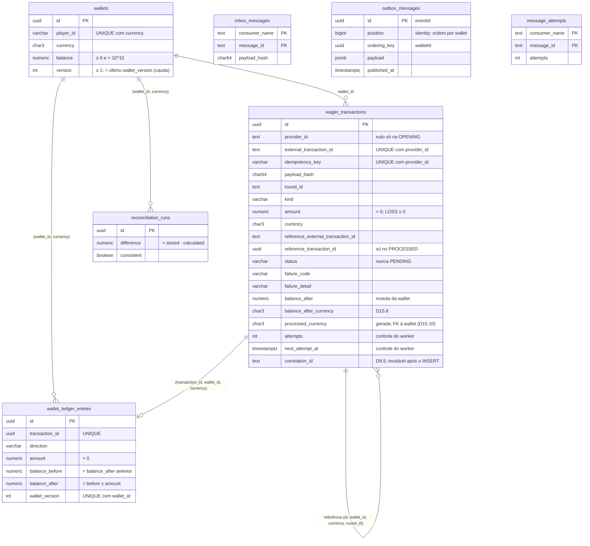

# wagering — persistência

Schema do Postgres (migrations em [`migrations/`](../../../../../migrations)) e mapeamento MikroORM. As garantias do §6 ficam **no banco**, não só no código (R-05-09, D7.3, D15).

## Peças

| Arquivo                                 | O que é                                                                                                                                                     | Regras            |
| --------------------------------------- | ----------------------------------------------------------------------------------------------------------------------------------------------------------- | ----------------- |
| `*.schema.ts`                           | Um `EntitySchema` por tabela, sobre um **record** plano (`WalletRecord`, `WagerTransactionRecord`, `WalletLedgerEntryRecord`). O domínio não conhece o ORM. | D7.1              |
| `*.mapper.ts`                           | Domínio ↔ record. Leitura sempre por `rehydrate` (R-06-03). `undefined` vira `null`. `PENDING` não vira record (D4.1).                                      | D4.1, D6.1, D14.5 |
| `index.ts`                              | `WAGERING_ENTITIES`, a lista registrada no ORM.                                                                                                             |                   |
| `outbox-message.schema.ts`, `reconciliation-run.schema.ts` | Linhas que o use case grava na outbox (sem `position`, que é identity, e sem as colunas do publisher) e nas execuções de reconciliação. | D6.9, D9.2, D9.3 |
| `mikro-orm-unit-of-work.ts`             | `UnitOfWork` da `application/`: `em.transactional()` num `EntityManager` novo por chamada, com os repositórios presos a ele. O `insert` da wallet faz flush na hora e traduz o `wallets_player_currency_uq` em `DuplicateWalletError`. | D3, D6.3, D7.1 |
| `src/shared/orm/decimal-amount.type.ts` | Tipo customizado: `numeric(20,2)` ↔ string; um `number` em qualquer direção lança erro.                                                                     | D2.4, D7.1        |
| `src/shared/orm/fk-id.ts`               | FK mapeada como id (string), declarada `m:1` só para o flush inserir wallet → transação → lançamento nessa ordem.                                           |                   |
| `src/shared/orm/create-orm.ts`          | `MikroORM.init` com `lock_timeout` 2 s e `statement_timeout` 5 s em toda conexão.                                                                           | D5                |
| `src/shared/orm/orm.module.ts`          | `ormModule(entities)`: uma instância do `MikroORM` por processo, com as credenciais do `SecretsProvider`; fecha no shutdown.                                | D12.3             |

Nenhum schema usa `version: true`: a `version` da wallet sobe só em `Wallet.debit`/`credit` (D7.2). A segunda camada é do banco: `UNIQUE (wallet_id, wallet_version)` + trigger de cauda (D15.7).

As colunas de controle do worker (`attempts`, `next_attempt_at`, `locked_until`) existem na tabela, mas ficam fora da entidade e do record (D4.5). O worker da S5 as usa por SQL próprio.

O `correlation_id` (D9.5) **não** é coluna de controle: é o rastreio da submissão. Ele está no record, mas não na entidade: o repositório (S4) o recebe ao salvar e o passa ao `wagerTransactionToRecord`. É gravado no `INSERT` e imutável depois (trigger `wager_transactions_guard_update`).

## Modelo de dados



`inbox_messages`, `outbox_messages` e `message_attempts` não têm FK: guardam mensagens, não estado financeiro.

## Papéis

| Papel            | Uso                              | Privilégios                                                                                                                                                                                                                                                                                   |
| ---------------- | -------------------------------- | --------------------------------------------------------------------------------------------------------------------------------------------------------------------------------------------------------------------------------------------------------------------------------------------- |
| `postgres`       | só o init do container           | superusuário                                                                                                                                                                                                                                                                                  |
| `wagering_owner` | migrations (`DB_MIGRATION_USER`) | dono do banco e das tabelas                                                                                                                                                                                                                                                                   |
| `wagering_app`   | aplicação e testes (`DB_USER`)   | `SELECT`/`INSERT` em tudo. `UPDATE` só em `balance`/`version`/`updated_at` da wallet, nas transações (com trigger), em `processed_at` da inbox, nas colunas de controle da outbox e em `message_attempts`. **Nada** de `UPDATE` no ledger e na reconciliação. **Nenhum** `DELETE`/`TRUNCATE`. |

Os papéis nascem em `scripts/postgres-init.sh` (só roda em volume novo); os `GRANT`s estão nas migrations.

## Garantias e testes

Todos com o papel da app, menos os marcados "dono": com a app, o privilégio recusa antes do trigger, então o trigger só é provado com o dono.

| Garantia                                                         | No banco                                                                                                                              | Teste (`test/integration/schema/`)                           |
| ---------------------------------------------------------------- | ------------------------------------------------------------------------------------------------------------------------------------- | ------------------------------------------------------------ |
| Saldo ≥ 0                                                        | `wallets_balance_non_negative_ck`                                                                                                     | `wallets.spec.ts`                                            |
| Teto de saldo (D15.2)                                            | `wallets_balance_limit_ck`                                                                                                            | `wallets.spec.ts`                                            |
| Uma wallet por player + moeda                                    | `wallets_player_currency_uq`                                                                                                          | `wallets.spec.ts`                                            |
| Key e id externo únicos por provedor (D3.1, D3.2)                | `wager_transactions_provider_key_uq`, `…_provider_external_uq`                                                                        | `wager-transactions.spec.ts`                                 |
| Uma reversão `PROCESSED` por referência (D1.1)                   | índice parcial `wager_transactions_one_processed_reversal_uq`                                                                         | `wager-transactions.spec.ts`                                 |
| Uma `OPENING` por wallet; `OPENING` sem provedor (D6.1)          | `wager_transactions_one_opening_uq`, `…_provider_columns_ck`                                                                          | `wager-transactions.spec.ts`                                 |
| Referência por kind (D1.5); valor > 0, `LOSS` ≥ 0 (D2.3)         | `…_reference_by_kind_ck`, `…_amount_ck`                                                                                               | `wager-transactions.spec.ts`                                 |
| Referência da mesma wallet, moeda e rodada                       | FK `wager_transactions_reference_scope_fk`                                                                                            | `wager-transactions.spec.ts`                                 |
| Coerência por status (D15.3)                                     | `…_status_ck`, `…_processed_ck`, `…_rejected_ck`, `…_failed_ck`, `…_pending_reference_ck`, `…_failure_detail_ck`, `…_reference_id_ck` | `wager-transactions.spec.ts`                                 |
| Terminal não muda; colunas da submissão imutáveis (D15.5)        | trigger `wager_transactions_guard_update`                                                                                             | `wager-transactions.spec.ts`                                 |
| `INSERT` não grava `FAILED`: ele só nasce de `PENDING_REFERENCE` (D15.5) | trigger `wager_transactions_guard_insert` | `wager-transactions.spec.ts` |
| Lançamento só de transação `PROCESSED` que move saldo, com a direção do kind; `PROCESSED` que move saldo tem lançamento (D15.9) | constraint triggers diferidos `wallet_ledger_entries_transaction_match` e `wager_transactions_ledger_entry` | `ledger-transaction-coherence.spec.ts` |
| Ledger append-only (R-05-05)                                     | sem privilégio + trigger `wallet_ledger_entries_append_only` (dono)                                                                   | `ledger.spec.ts`                                             |
| Aritmética e sinal do lançamento                                 | `wallet_ledger_entries_arithmetic_ck`, `…_amount_positive_ck`, `…_balances_non_negative_ck`                                           | `ledger.spec.ts`                                             |
| Encadeamento, sem furo; primeiro lançamento de 0; `OPENING` só como primeiro (D15.6)                                   | trigger `wallet_ledger_entries_chain`                                                                                                 | `ledger.spec.ts`                                             |
| Saldo e versão = último lançamento no commit (D15.1)             | constraint triggers diferidos `wallets_ledger_tail`                                                                                   | `ledger.spec.ts`, `wallets.spec.ts`                          |
| Saldo observado na moeda da wallet (D15.8) | FK `wager_transactions_balance_currency_fk`, `…_balance_after_pair_ck` | `wager-transactions.spec.ts` |
| Transação `PROCESSED` (inclusive `LOSS`) na moeda da wallet; `REJECTED` por `CURRENCY_MISMATCH` aceita (D15.10) | coluna gerada `processed_currency` + FK `wager_transactions_processed_currency_fk` | `wager-transactions.spec.ts` |
| Um lançamento por transação; moeda e transação coerentes (D15.4) | `…_transaction_uq`, `…_wallet_currency_fk`, `…_transaction_fk`                                                                        | `ledger.spec.ts`                                             |
| Dois escritores sem lock → um recusado (D15.7)                   | `wallet_ledger_entries_wallet_version_uq`                                                                                             | `ledger.spec.ts` (corrida real, sincronizada por `pg_locks`) |
| Inbox por `(consumer_name, message_id)` (D3.7)                   | `inbox_messages_pk`                                                                                                                   | `messaging-and-reconciliation.spec.ts`                       |
| Reconciliação append-only (D6.9)                                 | sem privilégio + trigger `reconciliation_runs_append_only` (dono)                                                                     | `messaging-and-reconciliation.spec.ts`                       |
| Papel restrito                                                   | `GRANT`s das migrations                                                                                                               | `privileges.spec.ts`                                         |

Os triggers diferidos (cauda e D15.9) conferem no `COMMIT` e releem as linhas, porque transação, lançamento e saldo são gravados em comandos separados. Os triggers levantam SQLSTATE `23000` com o nome da garantia em `constraint`, como as constraints nativas.

Mapeamento (valor além de 2^53 centavos exato, `version` sem incremento do ORM, `correlation_id` gravado no `INSERT`, prazos da conexão): `test/integration/persistence/orm-mapping.spec.ts` e `test/unit/persistence/`.

## Migrations

```bash
bun run migration:up       # aplica as pendentes (papel dono, .env)
bun run migration:down     # desfaz todas
bun run migration:verify   # up → down → up no banco de teste (R-04-07)
```

O `migration:verify` exige que o down deixe o schema `public` vazio e que o segundo up recrie **exatamente** o schema do primeiro: colunas, constraints, índices, triggers, funções (corpo incluído) e `GRANT`s, comparados pelas definições que o Postgres reconstrói (`pg_get_*def`).

SQL escrito à mão, lista explícita em `migrations/index.ts`, sem snapshot. Migration aplicada nunca é editada: crie outra.
